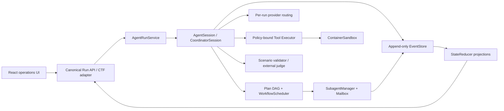

# ZHULONG-X

ZHULONG-X 是面向受控网络安全任务的人机协同智能体。Agent Engine v3 使用原生 Python
编排内核，把计划、任务、Agent、工具、证据、验证、预算和人工接管写入同一条可恢复事件流。

## 核心能力

- 版本化 Plan DAG、Fact / Hypothesis / Evidence / DecisionRecord 状态。
- `CoordinatorSession` 与 `SubagentManager`：角色限权、并发上限、fork/resume/cancel/join、mailbox、独立 transcript/checkpoint。
- declarative workflow：series、parallel、retry、race、loop-until、review、refute、synthesize、vote、human gate。
- OpenAI-compatible 原生 tool transcript，稳定 `tool_call_id`，有界并行只读/幂等调用。
- per-run provider/model/gateway/温度/token/超时/并行配置；凭据只从服务配置注入。
- append-only 规范事件与 `StateReducer` 重放；checkpoint、进程重启恢复、SSE 与增量事件游标。
- Artifact inventory：文本、结构化文件、压缩包、PDF、Office、图片、PCAP、ELF/PE/APK 元数据与 hash。
- CTF、渗透测试、漏洞分析、应急响应、逆向/取证五类场景 workflow。
- 默认禁网、scope allowlist、PolicyEngine、ContainerSandbox、审批标记、进程树终止和发布包检查。
- 候选状态区分 detected、locally validated、pending external、accepted、rejected；没有 evaluator 时保留证据等待外部判题。

## 架构



正式 API 不 import 或实例化 `CTFAgentOrchestrator`、旧 `AgentRuntime` 或 `CcBridgeRuntime`。
这些模块仅保留用于历史兼容测试和显式研究，不参与默认选择，也没有 silent fallback。

## 快速启动

要求 Python 3.11+、Node.js 18+。生产工具执行还要求本机已有 Podman/Docker 和预加载的
`AGENT_SANDBOX_IMAGE`，引擎不会自动拉取镜像或回退到宿主执行。

```bash
python3 -m venv .venv
source .venv/bin/activate
pip install -r backend/requirements.txt
cp .env.example .env

cd backend
python -m uvicorn app.main:app --host 127.0.0.1 --port 8000
```

```bash
cd frontend
npm install
npm run dev
```

API 文档：<http://127.0.0.1:8000/docs>

## 模型配置

凭据使用环境变量或部署 secret。不得把 key 写入请求、事件、checkpoint、前端或报告。

```dotenv
LLM_ENABLED=true
LLM_PROVIDER=openai_compatible
LLM_BASE_URL=https://gateway.example/v1
LLM_MODEL=competition-model
LLM_API_KEY=replace_me
AGENT_SANDBOX_RUNTIME=podman
AGENT_SANDBOX_IMAGE=python:3.11-slim
```

每次 `POST /api/agent/runs` 可以选择 credential-free 的 `provider`、`model`、
`gateway_profile`、`base_url`、`temperature`、`max_tokens`、`model_timeout_seconds` 和
`parallel_tool_calls`。API key 始终由后端按 profile 注入。

## 规范 API

| 接口 | 用途 |
| --- | --- |
| `POST /api/agent/runs` | 创建通用 v3 run |
| `POST /api/agent/runs/{run_id}/start` | 启动或恢复 |
| `POST /api/agent/runs/{run_id}/stop` | 传播 abort 到 session/sandbox |
| `GET /api/agent/runs/{run_id}` | 当前 reducer state |
| `GET /api/agent/runs/{run_id}/events?after_sequence=N` | 增量规范事件 |
| `GET /api/agent/runs/{run_id}/events/stream` | SSE 事件流 |
| `GET /api/agent/runs/{run_id}/projection` | Plan/Agent/证据/预算投影 |
| `GET /api/agent/runs/{run_id}/workflow` | 场景 manifest、Plan 和 WorkflowSpec |
| `POST /api/agent/runs/{run_id}/human-answer` | 记录回答并恢复 checkpoint |
| `POST /api/agent/runs/{run_id}/external-validation` | 回写外部接受/拒绝 |
| `GET /api/agent/runs/{run_id}/audit` | 导出脱敏审计记录 |

`/api/ctf` 保留队员熟悉的任务接口，但创建 session 时调用同一个 `AgentRunService`，并从同一
EventStore 投影兼容字段。

## 工具与策略

一个 `ToolDefinition` 同时绑定 schema、executor、权限、风险、超时、idempotency、side effect、
resource locks、parallel safety、approval 和 evidence type。只有只读/幂等、明确 parallel-safe 且
锁不冲突的调用进入有界并行；写操作、执行、网络和候选提交保持串行或审批。

生产默认使用 `ContainerSandbox`。`LocalTestSandbox` 仅用于 deterministic fixture 和测试，
`release_capable=false`。网络访问同时要求 run authorization、allowlist 和 PolicyEngine 通过。
ScopeGuard 继续保护旧工具入口。

## 人工协同

`human_required` 不是单一状态字符串。投影包含已完成工作、事实与证据、失败路径、最小阻塞点、
结构化问题、推荐下一步、风险和 checkpoint sequence。前端可直接回答并恢复同一个 run。

没有权威 CTF evaluator 时，候选进入 `pending_external`。队员将平台判题结果回写后，同一
AgentSession 进入成功或恢复探索，不会把“格式像 flag”包装成成功。

## 测试

```bash
# Agent Engine v3
python -m pytest -q backend/tests/test_agent_engine_*.py

# 完整后端
python -m pytest -q

# 前端类型与生产构建
cd frontend && npm run build

# 发布门禁
make release-check
make safety-audit
```

测试与 benchmark 报告必须区分：

1. deterministic mock harness：协议、事件、恢复和 evaluator 集成，不代表解题率；
2. offline fixture benchmark：本地受控文件/工具与隐藏 evaluator；
3. live-model benchmark：实际 provider，记录 token、成本、耗时、成功率与人工介入率。

`benchmarks/results/latest.json` 当前标签为 `agent_session_mock_hidden_25`，包含 25 题、5 场景、
每题 3 次。它是 mock 结果，不是 live-model solve rate。

## 发布

```bash
python scripts/package_release.py
python scripts/check_release.py
```

发布包为 `cyberpilot-finalops-v4-submission.zip`。打包器排除 `.env`、数据库、上传原件、运行证据、
checkpoint、vendor、`.skills`、`node_modules`、VCS 与缓存；`check_release.py` 检查跟踪文件、
敏感模式和必要文档。

## 文档

- [v3 baseline audit](docs/refactor/00-baseline-audit.md)
- [v3 ADR](docs/refactor/05-agent-engine-v3-adr.md)
- [file-level migration plan](docs/refactor/06-v3-file-plan.md)
- [architecture](docs/architecture_v3.md)
- [security boundary](docs/security_boundary.md)
- [developer guide](docs/developer_guide.md)
- [evaluation plan](docs/evaluation_plan.md)
- [operator manual](docs/user_manual.md)
- [failure playbook](docs/failure_playbook.md)

## 安全边界

所有任务必须来自受控任务目录和明确 scope。默认禁网；高风险动作需要 policy/approval；上传原件
只读，派生文件写入 run workspace；事件与 checkpoint 在落盘前脱敏。不要把 API key、真实环境
凭据、用户证据、运行数据库或隐藏 evaluator 提交到仓库和发布包。
