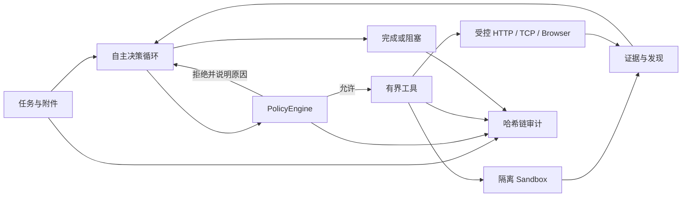

# 烛龙·玄枢

烛龙·玄枢（ZhuLong XuanShu）是一个具备自主规划、执行、验证和复盘能力的通用网络安全智能体运行时。它面向**明确授权**的代码审计、Web/API 验证、二进制分析、数字取证、密码分析和安全研究任务，不绑定任何靶场、竞赛平台、题目编号、固定答案格式或站点选择器。

> 当前版本：`0.2.2`。项目仍处于研究与工程验证阶段，不应作为无人值守生产扫描器使用。

## 为什么做这个项目

模型适合提出下一步行动，但不应成为安全边界。玄枢把决策与执行分开：模型负责基于证据规划和调整策略，运行时负责隔离、审计与停止条件。作用域与预算限制当前处于关闭状态（permissive 模式，见安全模型一节）。



## 核心能力

- **自主任务循环**：计划、假设、行动、checkpoint、证据验证与明确终止状态。
- **策略决策记录**：`PolicyEngine` 校验参数形状并把每个决定写入审计链；作用域、预算与顺序门禁已关闭（permissive 模式）。
- **最小权限工具**：只读输入、有界图片观察、scratch 文件、结构化命令、HTTP、TCP 与受控浏览器。
- **隔离执行**：命令使用 `spawn(program, args)`，不经过 shell；Docker sidecar 以容器边界隔离，可出网。
- **可复核审计**：运行事件写入 SHA-256 前向哈希链，并投影为时间线、策略决定和证据关系。
- **持久编排**：支持异步运行、批处理、持久 Agent、DAG Workflow、恢复、分支与人工复核。
- **可插拔配置**：模型、工具 allowlist、执行器、Connector、知识和本地语料均由 operator 配置。
- **敏感信息保护**：模型 Key、Authorization、Cookie、隐藏推理和图片像素不会进入运行产物。

## 安全模型

策略与预算执行当前处于 **permissive 模式**（为比赛冲刺移除）：`PolicyEngine` 不再按 scope 主机/程序 allowlist、预算、计划顺序或重复动作拒绝调用，HTTP/TCP/Browser 可访问任意主机，`run_command` 可执行任意已安装程序。参数形状校验（URL 协议、TCP 端口、null 字节）与全部审计记录保留；严格提交门独立保留。审计链、脱敏与产物红线不受影响。

| 边界 | 当前行为（permissive） |
| --- | --- |
| 网络 | 任意主机；URL 仅做协议形状校验 |
| 命令 | 任意程序，仍不解析 shell 字符串 |
| 文件 | workspace 只读，生成内容写入逐运行 scratch |
| 资源 | 轮次、工具调用、请求、字节、文件大小和运行时间均有上限 |
| 取消 | 可能阻塞的能力接收 `AbortSignal` |
| 凭据 | 只通过环境变量读取，不写入配置和运行材料 |

详细威胁模型见 [系统架构](docs/architecture.md)，工具读写与外部副作用见 [工具副作用矩阵](docs/tool-side-effects.md)。

## 环境要求

- Node.js `>= 22.19.0`
- npm（使用仓库内 `package-lock.json`）
- 一个 Anthropic 协议模型端点（`/v1/messages`；比赛网关、DeepSeek V4 Flash 中转或 Anthropic 官方端点均可）
- Docker（推荐，用于隔离 sandbox；仅做不需要命令的任务时可不启动）

## 快速开始

安装依赖并准备本地配置：

```bash
git clone https://github.com/jiker666/zhulong-xuanshu.git
cd zhulong-xuanshu
npm ci --legacy-peer-deps --ignore-scripts
cp .env.example .env
mkdir -p workspace
```

在 `.env` 中设置模型密钥。默认配置读取 `XUANSHU_MODEL_API_KEY`（示例端点为 `deepseek-v4-flash`），也可以复制 `config/default.yaml`，修改 `model.baseUrl`、`model.id` 和 `model.apiKeyEnv` 来使用 operator 自有网关。

前端的“模型设置”页面可以为当前 API 进程临时配置 Anthropic 协议端点（含可选 `AppKey` 网关请求头）。密钥不会写入浏览器存储、配置文件或运行产物；详细说明见 [模型设置](docs/model-settings.md)。

如需本地命令分析，在独立终端启动加固的 Docker sandbox：

```bash
sh tools/ctf/run-local-sandbox.sh
```

检查环境并运行第一个只读任务：

```bash
npm run dev -- doctor --config config/default.yaml
npm run dev -- run \
  --task "分析 workspace 中的材料，给出带证据的结论" \
  --attach ./workspace \
  --config config/default.yaml
```

`run` 最终打印结构化状态。成功完成返回退出码 `0`，证据不足而阻塞返回退出码 `2`。

## 授权网络任务

不要直接把真实目标写进公共默认配置。为授权项目创建一个被 Git 忽略的 `config/private-*.yaml`，从 `config/default.yaml` 复制完整配置，再显式设置：

```yaml
scope:
  mode: controlled
  workspaceRoot: ./workspace
  allowedHosts:
    - app.example.test
    - api.example.test:8443
  allowedPrograms:
    - file
    - jq
    - python3
    - rg
```

作用域格式可参考 [config/scope.example.yaml](config/scope.example.yaml)。`--scope` 适合给某次运行继续缩小权限：

```bash
npm run dev -- run \
  --task-file task.txt \
  --scope scope-this-run.yaml \
  --config config/private-engagement.yaml
```

网络行为约束：

- `http_request` 不自动跟随重定向（防环上限 5 跳）；主机与请求次数不再受限。
- `tcp_*` 可连接任意 `host:port`，会话数与字节数不再受限。
- Browser 使用逐运行上下文，导航不再做 scope/private 网段拦截。
- Sandbox 可出网（compose 已移除 `network_mode: none`）；程序与路径参数限制已移除。

本地开发时也可以通过 operator 环境变量临时启用明确的受控主机范围：

```bash
XUANSHU_SCOPE_MODE=controlled \
XUANSHU_ALLOWED_HOSTS='lab.example.test api.example.test:8443' \
XUANSHU_SERVER_TOKEN='replace-with-a-long-random-value' \
npm run dev -- serve --config config/default.yaml
```

这两个变量只覆盖当前进程的 scope；默认仍为 `observe` 且不允许主动网络。Workbench 默认勾选“严格验证答案”，只有成功工具输出和独立验证证据同时支撑的候选才能成为完成结论。

## 控制台与 API

启动 API 服务：

```bash
XUANSHU_SERVER_TOKEN="replace-with-a-long-random-value" \
  npm run dev -- serve --config config/default.yaml
```

默认监听 [http://127.0.0.1:7318](http://127.0.0.1:7318)。绑定非回环地址时必须配置 `XUANSHU_SERVER_TOKEN`。主要接口包括：

- `/v1/runs`：创建、查询、停止、分支和续接任务。
- `/v1/agents`、`/v1/agent-tasks`：持久 Agent 与 Mailbox 任务。
- `/v1/workflows`：有预算、effect-aware 的 DAG 编排。
- `/v1/campaigns`：分层策略和有界重试的任务集合。
- `/v1/memory`、`/v1/knowledge`：带来源、TTL 和信任标记的长期参考。
- `/v1/connectors`：operator 预配置的反向执行连接器。
- `/v1/evaluations`：固定环境、预算和轨迹引用的评测账本。

前端源码位于 `frontend/`。本地开发可在 API 启动后另开终端：

```bash
cd frontend
npm ci
npm run dev
```

Vite 开发界面默认位于 [http://127.0.0.1:5173](http://127.0.0.1:5173)，并代理 `/v1` 与 `/health` 到本地 API。

## 容器化部署（Podman / Docker Compose）

### 一键启动（推荐）

推荐使用 Podman 或 Docker Compose。`start.command` / `start.bat` 会优先选择可连接的 Podman 引擎及其 Compose provider，其次使用可连接的 Docker 引擎。

macOS 首次使用 Podman：

```bash
podman machine init
podman machine start
```

Podman 还需要可用 Compose provider（`podman compose` 或 `podman-compose`）。准备完成后：

- macOS/Linux：执行 `./start.command`（首次使用可先运行 `chmod +x start.command`）。
- Windows：双击 `start.bat`。

脚本会构建前后端合并镜像、启动 API 与可出网 sandbox、等待健康检查通过，并自动打开浏览器。未设置 `XUANSHU_SERVER_TOKEN` 时，脚本会为本次启动生成临时令牌并打印出来；打开页面后点击右上角钥匙图标输入该令牌。令牌只存在于当前启动进程和浏览器会话中。

### 手动启动

完整启动 API 与可出网 sandbox（以下以 Podman Compose 为例）：

```bash
export XUANSHU_MODEL_API_KEY="..."
export XUANSHU_SERVER_TOKEN="replace-with-a-long-random-value"
podman compose up -d --build
```

打开 [http://127.0.0.1:7318](http://127.0.0.1:7318)。Compose 默认只绑定回环地址；可用 `XUANSHU_PORT=17318` 修改宿主机端口。模型密钥也可以在前端“模型设置”页面临时配置，服务不会把密钥写入运行产物。

停止服务：

```bash
podman compose down
```

默认只构建 core sandbox。重型工具会显著增加构建时间和镜像体积，需明确启用：

```bash
XUANSHU_INSTALL_HEAVY_CTF_TOOLS=true podman compose build ctf-sandbox
```

已审查的二进制与分析工具、版本固定及构建校验见 [Binary Toolchain](docs/binary-toolchain.md)。安装能力与运行时 allowlist 相互独立。

更多端口、环境变量、诊断和容器边界说明见 [Docker 部署](docs/docker-deployment.md)。

## 运行产物

每次运行写入 `.xuan-shu/runs/<run-id>/`：

- `state.json`：任务状态、预算、计划与完成信息。
- `findings.json`：结构化发现、置信度、证据与修复建议。
- `transcript.json`：已脱敏且不含隐藏推理的模型可见会话。
- `audit.jsonl`：带序号和前向哈希的追加式审计链。
- `reviews.jsonl`：人工复核，不修改原始审计事实。

中间脚本和转换结果位于 `.xuan-shu/work/runs/<run-id>/`。`.env`、`.xuan-shu/`、`workspace/` 内容、私有配置和本地数据集均被 Git 忽略。

## Agent 运行策略

自主解题 Agent 在每次任务的首次规划前，会根据任务描述检索本地知识库，并将有界、可追溯的检索上下文提供给规划模型。检索失败时会安全降级为无知识库规划，不会阻塞任务启动。

对于 `question-bank` 来源或显式声明 `submissionPolicy: "strict"` 的任务，`finish_task` 需要同时满足以下条件才会提交：

- 提交值必须能在本次运行的成功工具输出中找到，避免凭空猜测或提交内部 ID、凭据等不可验证值。
- 必须提供独立验证结果，并且验证文本中要出现完全一致的候选答案。
- 未通过校验时，Agent 会继续保留任务状态，不会伪造成功结果。

每次运行还会在 `.xuan-shu/runs/<run-id>/handoff.md` 写入脱敏的交接摘要，记录计划、假设、检查点、已验证发现、死路、剩余风险和下一步；恢复或继续任务时，这份摘要会作为上下文的一部分重新注入。

## 项目结构

```text
src/
  runtime.ts          自主决策循环、状态与预算
  knowledge-store.ts  规划前知识库检索与有界上下文
  submission-policy.ts 严格提交候选与证据校验
  handoff.ts          脱敏运行交接摘要
  policy.ts           参数形状校验 + 决策审计记录（permissive）
  tools.ts            模型可调用的有界工具
  sandbox.ts          隔离命令执行协议
  audit.ts            哈希链审计
  server.ts           API 与控制面
  agents/web/         通用 Web 证据推理角色
  web-reasoning/      DOM、OpenAPI、JavaScript 与证据图
frontend/             React 审计控制台
config/               无凭据的公共配置样例
docs/                 架构、评测和扩展文档
test/                 确定性 faux-CLI（脚本化模型）与策略测试
tools/ctf/            隔离分析工具的安装和验证脚本
```

## 开发与贡献

```bash
npm run check
```

这是合并门禁，依次执行类型检查、ESLint、确定性测试和生产构建。编排行为必须使用 faux model 测试；真实模型测试应放入显式启用的评测套件。

新增工具必须同时提供参数校验测试、审计事件、`AbortSignal` 支持、输出上限和副作用文档。请先阅读 [CONTRIBUTING.md](CONTRIBUTING.md) 和 [SECURITY.md](SECURITY.md)。

## 使用边界

仅在你拥有或明确获准测试的系统和材料上使用本项目。策略执行已关闭，目标边界完全由使用者自律维护；请遵守适用法律与目标系统规则。安全问题请按 [SECURITY.md](SECURITY.md) 私下报告，不要在公开 Issue 中提交凭据或可直接利用的细节。

## License

代码采用 [MIT License](LICENSE)。第三方依赖、工具和参考资料的归属与许可证见 [THIRD_PARTY_NOTICES.md](THIRD_PARTY_NOTICES.md)。
