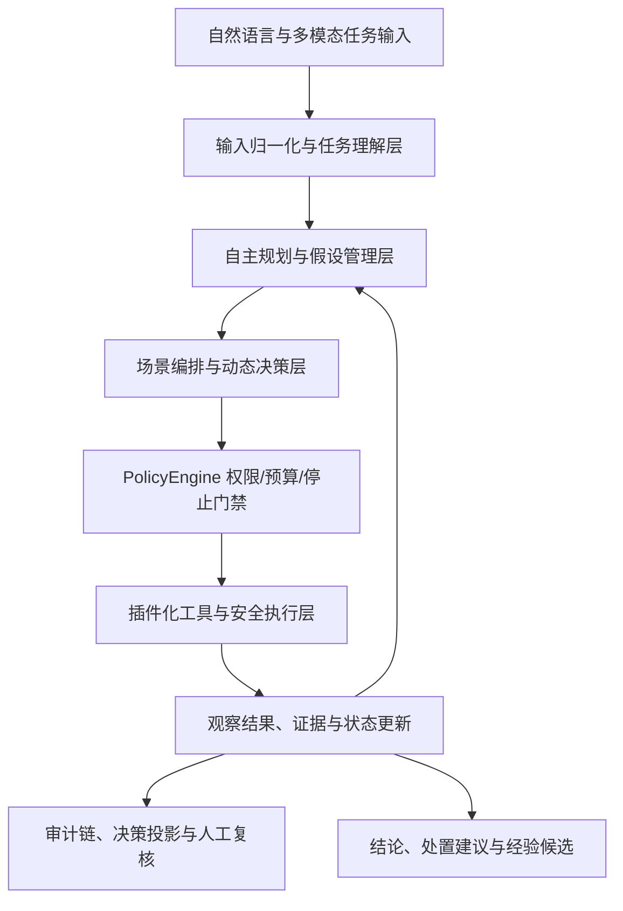

# XH-202609 具备自主决策能力的通用网络安全智能体

## 项目计划书

## 项目申报摘要

网络安全任务正在从“单点工具调用”转变为“开放环境下的连续决策”。同一个任务可能同时包含自然语言目标、接口文档、日志、压缩包、源代码、二进制文件和网络交互结果；智能体不仅要识别问题，还要判断证据是否充分、决定下一步行动、处理失败与干扰，并在授权边界内完成验证和处置。传统脚本自动化解决的是“按照预设流程执行”，普通大模型解决的是“生成分析建议”，二者都难以独立承担复杂安全任务的全过程。

烛龙·玄枢针对这一关键缺口，构建“DeepSeek V4 Flash 核心推理模型 + 统一自主决策内核 + 多场景安全 Agent + 标准化工具链 + PolicyEngine 安全门禁 + 证据审计闭环”的通用网络安全智能体。系统已经完成 Web、Pwn、Crypto、Reverse、Forensics、Malware、OSINT、Misc、AI/ML 和应急响应等方向的统一集成，能够对多格式任务输入进行归一化，自动生成执行计划，基于证据动态选择工具和策略，在失败后完成策略修订，并以可复核证据支撑最终结论。

本项目最具区别性的设计是：把“大模型的自主性”放在工程边界之内。模型可以提出假设、比较策略和选择下一步，但不能直接突破授权范围；所有主动网络能力必须经过 PolicyEngine，所有高风险动作受预算、停止条件和 checkpoint 约束，所有关键决策均进入带哈希校验的审计链。由此，系统同时具备自主性、专业性、可解释性和安全可控性，能够从竞赛环境平滑迁移到授权渗透测试、漏洞研究、应急响应、安全运营和安全教学等实际场景。

项目已完成 Web、Pwn、Crypto、Reverse、Forensics、Malware、OSINT、Misc、AI/ML 和应急响应等方向的独立能力建设与统一集成，以全方向实战能力证明通用性，以人机协同实战和隐藏集评测证明有效性，以越权率、证据正确率、恢复成功率和可复现性证明可靠性，形成了一套可部署、可审计、可扩展的通用网络安全智能体底座。

## 项目摘要与核心价值

### 1.1 一句话价值

让安全专家从“逐条命令和逐个页面操作”中解放出来，由智能体承担跨工具、跨证据和跨阶段的复杂工作，同时将最终决策权、风险边界和责任链保留在人和制度手中。

### 1.2 面向评审的核心判断

本项目不是一个固定题型的 Web 脚本，也不是一个只能输出安全报告的对话机器人，而是一套能够在授权范围内自主完成“理解—规划—行动—观察—验证—修订—结论”闭环的安全运行系统。它的竞争力来自四个层面的同时成立：

| 评审关切 | 本项目的直接回答 |
| --- | --- |
| 能不能理解复杂任务 | 支持自然语言、结构化文件、压缩包、日志、流量、代码、二进制和接口文档，并将其统一为任务对象、约束和完成标准 |
| 能不能真正执行 | 通过场景 Agent、工具注册表、sandbox 和受控网络工具完成可观测、可中断、可复现的行动 |
| 能不能自主调整 | 通过假设管理、策略比较、checkpoint、失败分类和恢复 Agent 避免固定脚本与无效重复 |
| 能不能安全使用 | 通过 PolicyEngine、operator-owned scope、预算、审计链、敏感信息脱敏和人工接管机制约束行为 |
| 能不能推广 | Web、Pwn、Crypto、Reverse、Forensics、Malware、OSINT、Misc、AI/ML 和应急响应共享同一决策内核与插件协议 |

### 1.3 项目竞争优势

第一，具有可运行的工程基础。系统不是停留在概念架构，而是已经具备 TypeScript 模块化实现、CLI、REST API、Docker Compose、sandbox sidecar、浏览器受控运行、运行状态持久化、审计台和自动化测试体系。

第二，具有可证明的安全边界。安全边界不依赖模型自觉，也不依赖提示词约束，而是由 PolicyEngine 和操作员配置在工具执行前强制判断。即使模型产生错误计划，越权主机、未授权端口、未允许程序、超预算动作和高风险浏览器操作仍会被系统阻断。

第三，具有跨方向迁移能力。不同安全领域的工具不同，但核心决策问题高度一致：识别目标、建立假设、获取证据、选择行动、验证结果、修订计划。项目将差异收敛在场景插件中，将通用能力沉淀在统一内核中，避免每增加一个方向就重新开发一套 Agent。

第四，具有面向真实评审的泛化设计。系统通过开发集、验证集、隐藏集、路径随机化、参数随机化、噪声注入和消融实验检验能力，避免依赖固定页面、固定文件名、固定工具顺序、固定 Flag 或题目记忆。

### 1.4 项目亮点与创新亮点

#### 亮点一：DeepSeek V4 Flash 驱动的自主安全决策

项目以 DeepSeek V4 Flash 作为核心推理模型，不停留在问答和报告生成，而是让模型参与任务理解、假设生成、策略比较、工具选择、失败分析和计划修订。模型能够根据实时证据动态决定下一步行动，真正参与安全任务全过程。

**价值体现：**将大模型的语言理解和推理能力转化为可执行的安全决策能力，显著减少人工在信息整理、工具选择和重复验证上的负担。

#### 亮点二：Web、Pwn、Crypto、Reverse、Forensics、Malware、OSINT、Misc、AI/ML、应急响应全方向完善

项目不是围绕单一 Web 场景开发的专用工具，而是已经完成多个网络安全方向的独立能力建设。每个方向均具备专属 Agent、专业工具链、领域知识、证据模型、结果验证和失败恢复机制，既能独立完成专业任务，也能进行跨方向联合研判。

**价值体现：**覆盖从漏洞研究、二进制分析、密码分析、样本研判、数字取证到应急处置的完整安全任务谱系，具备真正的“通用网络安全智能体”属性。

#### 亮点三：从自动化执行升级为“理解—规划—行动—验证—修订”闭环

系统不执行固定脚本，而是先理解目标和完成标准，再建立假设、制定计划、选择工具、观察结果、验证结论，并在工具失败、证据冲突、超时或策略拒绝后强制修订计划。

**价值体现：**解决传统安全自动化流程僵化、遇到异常无法恢复、大模型反复尝试和结论缺乏验证依据等问题，具备面向开放环境的自主适应能力。

#### 亮点四：模型能力与安全边界解耦

系统不把安全寄托在提示词或模型自觉上。DeepSeek V4 Flash 只能提出计划和工具调用请求，所有主动网络能力、命令执行、浏览器操作和高风险动作都必须经过 PolicyEngine、scope、工具注册表和预算门禁。

**价值体现：**即使模型出现误判，也不能突破授权主机、端口、程序、路径、动作次数和资源预算，保证智能体“能自主决策，但不能越权执行”。

#### 亮点五：证据驱动的可解释决策

系统对每个关键结论建立证据引用，记录任务理解、计划、假设变化、工具结果、策略判断、checkpoint、失败分类和最终结论；不保存隐藏思维链，只输出可复核的外显决策和证据链。

**价值体现：**评审人员和安全专家能够回答“为什么采取该行动、依据是什么、是否经过验证、失败后如何调整”，显著提升系统可信度和答辩说服力。

#### 亮点六：跨工具、跨 Agent、跨方向协同

系统采用“统一编排器 + 场景 Agent + 专业工具插件”的协同结构。不同方向的 Agent 可以共享任务状态、证据图谱和假设信息，并根据新证据自动在 Web、二进制、取证、样本和应急响应等方向之间 pivot。

**价值体现：**能够处理单方向任务，也能够处理“Web 入口发现—样本分析—日志取证—事件处置”等复杂组合任务，突破单工具和单场景 Agent 的能力边界。

#### 亮点七：面向真实环境的失败恢复机制

系统将失败划分为工具错误、权限拒绝、超时、空结果、证据矛盾、环境变化和策略失效等类别。失败后必须完成 checkpoint，明确说明失败原因、计划变化和下一步行动依据，禁止无变化重复执行。

**价值体现：**智能体不会因一次工具失败就停止，也不会陷入重复循环，具备更接近真实安全专家的诊断、调整和恢复能力。

#### 亮点八：全链路可审计、可复现、可验收

每次运行生成状态、发现、证据、结论和审计记录，审计链使用 SHA-256 前向哈希校验；评测固定模型、工具镜像、依赖、配置和数据集，并采用开发集、验证集、隐藏集和消融实验检验泛化能力。

**价值体现：**项目成果可以被复核、复现和量化评价，避免只展示一次成功演示，符合网络安全系统对责任追踪、过程留痕和工程质量的要求。

#### 亮点九：面向人机协同实战设计

系统支持三名队员与 Agent 协同工作，队员负责目标确认、风险判断、关键接管和最终决策，Agent 负责持续分析、工具编排、证据整理和重复操作。控制台提供运行状态、计划、策略门禁、证据、checkpoint、人工复核和紧急停止能力。

**价值体现：**不是用 Agent 替代安全人员，而是形成“人掌握责任和边界、Agent 扩展分析深度和执行广度”的协同模式，直接契合榜题终审的人机协同实战要求。

#### 亮点十：可部署、可扩展、可持续演进

项目支持 CLI、REST API、Docker Compose 和受控 sandbox 部署；场景能力通过插件方式管理，工具具有标准输入输出、预算、超时、AbortSignal、审计事件和副作用说明。

**价值体现：**既能满足竞赛现场的一键部署和快速演示，也能在授权渗透测试、漏洞研究、安全运营和应急响应中持续接入新工具、新协议和新场景。

### 一、项目概述

#### 1.1 项目名称

烛龙·玄枢——具备自主决策能力的通用网络安全智能体。

#### 1.2 项目定位

本项目面向 XH-202609 榜题提出的“能够理解复杂开放式安全任务，并完成感知、分析、决策、执行、验证和复盘闭环”的要求，研发一套面向受控网络安全实战环境的通用智能体系统。

系统采用 DeepSeek V4 Flash 作为核心推理模型，不把模型简单包装成问答机器人，也不把固定脚本堆叠成自动化工具，而是将模型作为负责任务理解、假设生成、策略比较和下一步行动选择的决策组件，将任务状态、证据、策略、工具权限、预算和审计作为由系统强制执行的工程边界，形成“模型负责判断、策略负责约束、工具负责执行、证据负责验证、审计负责追溯”的安全智能体架构。模型接入层采用标准化协议封装，便于在比赛网关、受控内网或离线评测环境中稳定部署，并在不改变安全边界的前提下进行模型替换和版本固化。

系统已经完成 Web、Pwn、Crypto、Reverse、Forensics、Malware、OSINT、Misc、AI/ML、应急响应、漏洞挖掘和逆向分析等方向的独立能力建设与统一集成。各方向均具备任务编排、专业分析、工具协同、证据管理、结果验证和失败恢复能力，并按照同一决策内核实现跨方向任务切换与联合研判，形成覆盖多类安全任务的通用网络安全智能体。

#### 1.3 总体目标

构建一个能够处理自然语言、结构化文件、压缩包、日志、流量、接口文档、源代码、二进制文件和多媒体证据的自主安全智能体，实现：

1. 自动理解任务目标、约束条件、输入材料和完成标准；
2. 自动完成任务拆解、优先级排序、假设生成和执行计划制定；
3. 根据实时证据在多种工具和策略之间动态选择与切换；
4. 在失败、拒绝、超时、矛盾证据和环境干扰下进行受约束的策略修订；
5. 对关键行动提供依据、证据、权限判断和结果记录；
6. 在授权范围内完成从威胁感知、分析研判到响应处置的闭环；
7. 通过确定性评测、消融实验和人机协同实战证明系统的有效性、鲁棒性和可复现性。

### 二、需求分析与问题定义

#### 2.1 传统安全自动化的局限

现有安全工具通常围绕单一任务设计，依赖人工选择工具、拼接命令和解释结果。当任务目标开放、输入格式不统一或现场证据发生变化时，固定流程容易出现以下问题：

- 只能处理预先定义的场景，难以理解开放式任务；
- 工具调用与结果解释相互割裂，无法形成连续决策；
- 缺乏失败恢复机制，遇到超时、误报或策略拒绝时容易重复尝试；
- 结论与证据关联弱，难以复核和审计；
- 经验难以沉淀为通用能力，容易对固定题型、固定参数或固定页面过拟合；
- 在引入大模型后，若没有独立策略边界，模型可能出现越权访问、无界循环、敏感信息泄露和危险动作扩散。

#### 2.2 本项目的核心问题

本项目重点解决的不是“让模型知道更多安全知识”，而是让智能体在真实变化环境中持续回答四个问题：

1. 当前任务真正要完成什么，什么才算完成？
2. 已有证据支持哪些假设，还缺少什么证据？
3. 下一步行动的收益、风险、成本和授权边界是什么？
4. 当前行动失败后，如何改变计划并证明没有陷入重复循环？

### 三、总体技术方案

#### 3.1 总体架构

系统采用六层架构：

#### 3.2 核心模型与推理策略

本项目以 DeepSeek V4 Flash 作为核心推理模型，负责将复杂安全任务转化为结构化计划，并在运行过程中结合观察结果进行策略选择和动态修订。选择该模型的核心考虑不是单纯追求模型参数规模，而是综合考虑安全任务所要求的长上下文理解、工具调用稳定性、结构化输出能力、推理吞吐、响应时延和部署成本。

在系统中，DeepSeek V4 Flash 主要承担五类工作：

1. **任务理解**：识别任务目标、输入材料、授权范围、限制条件和完成标准；
2. **假设生成**：根据初始证据提出可验证的漏洞、攻击路径、事件原因或样本行为假设；
3. **策略规划**：从候选工具和行动中选择优先级，并给出预期观察、成功标准和回退路径；
4. **动态决策**：根据工具结果、证据变化、策略拒绝和环境异常调整下一步动作；
5. **结论归纳**：将经过验证的事实、证据引用、置信度、影响范围和处置建议组织为结构化输出。

模型不直接拥有网络权限、文件系统权限或命令执行权限。DeepSeek V4 Flash 输出的计划和工具调用请求必须经过结构化格式校验、工具注册表和 PolicyEngine 三重检查，只有通过授权范围、预算、动作类型、路径、主机、端口和停止条件检查后，才会交由执行层运行。因此，模型能力负责提升决策质量，系统工程负责保证行为边界。

为保证模型运行稳定性，系统采用以下推理控制策略：

- 使用结构化任务对象和有限字段输出，减少自由文本对执行链的干扰；
- 将观察、假设、计划、证据和结论分离保存，避免上下文混淆；
- 通过 checkpoint 强制模型阶段性总结和重新规划；
- 通过重复动作限制和预算门禁抑制无效循环；
- 通过工具结果验证模型结论，禁止仅凭模型自报完成；
- 通过固定模型标识、运行配置、工具镜像和评测集保证结果可复现；
- 通过模型超时、重试、降级和人工接管机制保障现场连续运行。

DeepSeek V4 Flash 是本项目当前固化的主模型；模型适配层保留标准化路由能力，可根据比赛指定网关、部署环境和合规要求切换经过验证的兼容模型，但无论使用何种模型，均不得绕过同一套 PolicyEngine、scope、预算、审计和人工接管机制。

#### 3.3 输入归一化与任务理解

系统统一接收以下类型的输入：自然语言任务描述、JSON/YAML/CSV/HAR/OpenAPI 文件、日志、压缩文件、目录、图片、流量、源代码、二进制文件、样本元数据和接口文档。

输入层只负责解析、分类、摘要、哈希、格式识别和资源上限控制，不直接执行附件中的命令或脚本。系统为每个任务建立结构化任务对象，至少包括：目标、范围、输入、约束、完成标准、风险等级、可用资源、禁止行为和当前证据。

任务理解结果还会进行一致性检查：当任务描述、附件内容和运行范围不一致时，智能体必须先形成待确认假设，不得直接将不确定信息当作事实执行。

#### 3.4 自主规划与假设管理

规划模块将任务转化为可执行步骤，每个步骤包含：目标、前置条件、候选工具、预期观察、成功标准、失败分类、回退方案和下一次 checkpoint 条件。

智能体维护显式假设状态，包括 open、supported、contradicted、confirmed 四类状态，并把假设变化与证据绑定。这样可以避免只凭一次异常结果直接下结论，也便于在答辩中展示智能体如何从证据逐步收敛。

系统强制执行以下控制：

- 任何主动行动前必须提交计划；
- 连续行动达到阈值后必须 checkpoint；
- 工具失败或策略拒绝后必须分类失败、修改计划并说明下一步依据；
- 相同工具与相同参数重复达到上限后自动阻断；
- 只有满足证据和完成标准，才能进入完成状态；
- 无法继续时必须输出阻塞原因、已验证内容和建议人工接管点。

#### 3.5 场景编排与角色协同

系统采用“统一编排器 + 场景 Agent + 专业工具插件”的方式扩展能力。统一编排器负责任务生命周期和跨场景切换，场景 Agent 负责领域内的证据解释与策略选择，工具插件负责具体执行。

Web 场景已形成完整的角色链：

`Recon → Fingerprint → Vulnerability → Payload → Exploit → Verification → Recovery`。

全方向版本已形成以下场景插件：

| 场景 | 核心能力 | 典型输入 | 典型输出 |
| --- | --- | --- | --- |
| Web/API | 资产侦察、指纹识别、接口建模、漏洞验证、浏览器交互 | URL、HAR、OpenAPI、页面和响应 | 资产图、漏洞假设、验证证据、修复建议 |
| Pwn/二进制利用 | 文件识别、保护分析、崩溃定位、利用链规划、远程交互 | ELF、崩溃信息、服务地址、交互协议 | 漏洞根因、利用条件、可复现过程 |
| Crypto | 密码体制识别、随机性分析、数学建模、参数推断 | 密文、算法描述、交互样本 | 算法判断、推导过程、验证结果 |
| Reverse | 静态分析、动态分析、函数定位、控制流与行为推断 | PE、ELF、APK、字节码 | 行为摘要、关键路径、可验证结论 |
| Forensics | 时间线重建、文件系统、内存、流量和元数据分析 | 镜像、日志、PCAP、内存转储 | 事件时间线、关联证据、影响范围 |
| Malware | 样本分类、IOC 提取、配置解析、行为链分析 | 样本、沙箱输出、规则和日志 | IOC、TTP、危害判断、处置建议 |
| OSINT/Misc | 公开信息关联、编码解码、文档和多媒体取证 | 文本、图片、域名、文档 | 关联图、来源证据、可信度判断 |
| AI/ML 安全 | 模型输入输出分析、提示注入、数据和模型风险识别 | Prompt、模型响应、配置和样本 | 风险链、复现步骤、缓解方案 |
| 应急响应 | 告警归并、事件研判、遏制、根除、恢复和复盘 | 告警、日志、资产、处置手册 | 事件等级、处置计划、复盘报告 |

每个场景插件必须遵循统一接口，不能绕过统一状态机、工具注册表、PolicyEngine、预算和审计链。新增插件还必须配套策略测试、预算测试、审计事件、文档和副作用说明。

#### 3.6 工具协同与插件化扩展

工具层采用标准化注册表，每个工具声明输入模式、输出模式、能力类别、风险级别、资源消耗、超时、可否写入和需要的授权范围。工具按能力分为：

- 只读材料分析工具；
- 受控本地命令工具；
- 受控 HTTP、TCP 和浏览器工具；
- 证据整理、对比、统计和验证工具；
- 任务管理、checkpoint、结论和经验记录工具。

工具调用统一返回有界输出、状态、错误分类、摘要、证据引用和可复现参数。阻塞型操作统一接收 AbortSignal，确保超时、人工停止或全局取消能够及时释放资源。

#### 3.7 安全执行与权限门禁

PolicyEngine 是所有主动网络能力和高风险工具的必经边界。操作员配置定义 workspace、授权主机、端口、程序、预算和运行模式；单次运行的 scope 只能进一步收窄，不能新增主机、程序、路径或把 observe 提升为 controlled。

执行层采用 API/model 进程与 sandbox sidecar 分离的方式：模型进程负责决策，sidecar 负责受限命令执行；附件只读挂载，scratch、HOME 和临时目录按 run-id 隔离；远程网络能力只通过受控 HTTP/TCP/Browser 工具访问；模型密钥、授权头、Cookie 和隐藏推理不写入运行产物。

#### 3.8 可解释、可审计与可复现

系统不保存隐藏思维链，而是记录可复核的外显决策：任务理解摘要、计划、假设、候选工具、策略判断、PolicyEngine 结果、工具输入摘要、工具输出摘要、证据引用、checkpoint、失败分类、计划变化和最终结论。

每次运行生成带 SHA-256 前向哈希的 audit.jsonl，配套状态、发现、会话摘要、人工复核和结论文件。审计台以决策时间线展示“为什么做、依据是什么、是否在授权范围内、结果如何、失败后如何调整”。人工复核写入独立记录，不修改原始审计链。

### 四、各方向建设成果与统一决策内核

#### 4.1 已有 Web 能力

当前代码已具备较完整的 Web 智能体基础：

- WebOrchestrator 负责场景流程和角色切换；
- Recon、Fingerprint、Vulnerability、Payload、Exploit、Verification、Recovery 形成阶段化工作流；
- Web 状态机支持运行恢复和阶段历史持久化；
- Web reasoning 模块包含任务检测、规划、观察管理、假设管理、反思、响应差异、图谱、HTML/JavaScript/OpenAPI 分析；
- 浏览器运行时具备会话、页面、导航、DOM、网络摘要和动作边界；
- Web benchmark 支持基准评测、工具调用效率和完成度衡量；
- 既有 PolicyEngine、checkpoint、审计链、sandbox、范围和预算机制可直接复用。

#### 4.2 各方向协同与统一复用原则

各方向均已完成领域知识索引、领域观察器和领域工具适配器建设，并统一复用任务状态机、权限控制、审计、预算、恢复和评测框架。各方向共享统一的任务生命周期、权限边界、证据格式和评测协议，既能独立完成专业任务，也能在复杂任务中进行跨方向协同。

例如，Web 的“请求—响应—差异”对应 Forensics 的“日志—时间线—关联”、对应 Reverse 的“静态特征—动态行为—路径验证”、对应应急响应的“告警—处置动作—恢复状态”。所有场景都遵循“观察—假设—行动—验证—修订”的共同决策模型。

### 五、关键创新点

#### 5.1 受约束的自主决策闭环

将自主性定义为“在明确边界内自主理解、规划、选择、调整和验证”，而不是无边界执行。计划门禁、checkpoint、重复动作限制、失败分类和完成标准共同构成可控自主性。

#### 5.2 证据驱动的多策略动态规划

智能体不是沿着固定脚本运行，而是维护多条候选策略，并根据证据质量、成功概率、成本、风险和授权状态选择下一步。验证失败后必须修改策略，避免大模型常见的“重复同一动作”问题。

#### 5.3 跨场景通用决策内核

通过统一任务对象、状态机、插件接口和证据模型，把 Web、二进制、流量、样本、应急响应等不同任务映射到同一套闭环上，降低扩展成本并增强跨领域迁移能力。

#### 5.4 可审计的安全智能体

系统把策略决策、工具调用、授权判断、资源消耗和结论证据全部纳入审计链，使智能体的行为可解释、可追溯、可复现，满足安全行业对责任边界和操作留痕的要求。

#### 5.5 面向泛化而非题目记忆

评测中加入随机化路径、参数名、页面布局、文件名、Banner、日志噪声和工具顺序，严格区分开发集、验证集和隐藏集，避免通过固定选择器、固定题号、固定答案模板或固定 Flag 过拟合。

## 六、项目基础与可行性论证

### 6.1 技术基础

项目已形成较完整的自主安全智能体基础设施：

- 统一运行时负责任务生命周期、状态转换、预算和持久化；
- PolicyEngine 负责工具许可、网络范围、程序白名单、路径边界、重复动作、HTTP/TCP 预算和停止门禁；
- sandbox sidecar 将模型决策进程与命令执行环境分离，支持受限程序、独立 scratch 空间和资源上限；
- Web Agent 已形成侦察、指纹、漏洞、Payload、利用、验证、恢复的角色协同链；
- Web reasoning 已覆盖任务检测、规划、观察管理、假设管理、反思、响应差异、HTML、JavaScript、OpenAPI 和图谱分析；
- 运行系统支持审计链、决策投影、人工复核、经验候选和可复现实验账本；
- 测试体系包含策略、运行时、浏览器、Web 推理、图谱、经验、审计、沙箱和评测测试，当前工程门禁覆盖超过 300 项自动化测试。

上述基础说明项目已经解决了通用智能体最难落地的部分：状态如何持续、动作如何受控、失败如何恢复、结果如何复核。各方向能力均已在统一底座上完成场景适配、工具集成和独立验证，系统具备完整的全方向交付能力。

### 6.2 工程可行性

项目采用 TypeScript 模块化架构，场景 Agent、工具适配器、策略模块和评测模块边界清晰；采用标准化输入输出和插件接口，便于新增安全能力；采用 Docker 和 sidecar 方式封装执行环境，降低部署差异；采用配置文件管理模型、scope、预算和沙箱，不将密钥和授权头写入代码或运行产物。

系统支持三种部署形态：本地 CLI 适合开发和离线分析，REST API 适合平台化接入，Docker Compose 适合比赛和受控环境一键部署。默认模型配置为 DeepSeek V4 Flash，模型地址、版本标识、上下文窗口、最大输出和超时策略均通过配置管理；该部署方式既满足榜题要求的程序材料和完整部署手册，也便于答辩现场快速启动和演示。

### 6.3 场景可行性

全方向能力并非简单把工具清单并列，而是为每个方向定义“输入—观察—假设—行动—验证—输出”的闭环：

| 方向 | 决策闭环 | 代表性专业能力 | 可验收成果 |
| --- | --- | --- | --- |
| Web/API | 资产识别 → 接口建模 → 漏洞假设 → 受控验证 → 证据确认 | DOM、JavaScript、OpenAPI、浏览器、响应差异和时序分析 | 漏洞证据、影响说明、复现过程和修复建议 |
| Pwn | 二进制画像 → 保护分析 → 崩溃定位 → 利用假设 → 本地/远程验证 | ELF、保护机制、调试、ROP、协议交互和利用链 | 根因定位、利用条件、验证记录和风险说明 |
| Crypto | 算法识别 → 参数建模 → 数学假设 → 计算验证 → 结果复核 | 随机性、数论、编码、协议和参数关系分析 | 推导过程、关键中间证据和可重复验证 |
| Reverse | 文件识别 → 静态定位 → 动态观察 → 行为假设 → 路径确认 | 控制流、字符串、函数、字节码、动态行为和配置提取 | 行为链、关键函数、配置摘要和结论依据 |
| Forensics | 证据保全 → 时间线构建 → 关联分析 → 事件假设 → 独立验证 | 文件系统、内存、流量、日志、元数据和时间线 | 时间线、IOC、关联证据和影响范围 |
| Malware | 样本识别 → 静态提取 → 动态行为 → IOC/TTP 关联 → 风险研判 | 配置、通信、持久化、行为链和规则化摘要 | 样本画像、IOC、TTP、危害等级和处置建议 |
| OSINT/Misc | 信息提取 → 来源关联 → 可信度评估 → 交叉验证 → 结论 | 文档、图像、编码、公开来源、实体关系和多媒体取证 | 来源链、实体关系、可信度和证据包 |
| AI/ML 安全 | 输入构造 → 输出观察 → 风险假设 → 复现实验 → 缓解验证 | 提示注入、模型越权、数据泄露、输出安全和模型行为评估 | 风险链、复现步骤、影响分析和缓解方案 |
| 应急响应 | 告警归并 → 事件定级 → 范围研判 → 遏制处置 → 恢复复盘 | 日志、资产、进程、网络、配置、处置手册和时间线 | 事件报告、处置记录、恢复验证和改进建议 |

### 6.4 应用可行性

系统首先适用于授权实验室、竞赛平台、教学靶场和安全研究环境。在此基础上，可通过进一步加强租户隔离、出口代理、微虚拟机、DNS 锁定、凭据托管和外部审计存储，逐步服务于企业安全运营、渗透测试、漏洞管理和应急响应。项目始终以“明确授权、最小权限、可审计、可人工接管”为进入真实业务环境的前提。

### 七、实施计划

#### 建设成果一：统一内核与全方向能力建设（已完成）

目标是完成可运行、可部署、可演示的 Web 主线版本：

- 固化输入归一化、任务理解、规划、状态机、checkpoint 和结论输出；
- 完成 Web 七角色闭环和浏览器受控运行；
- 补齐部署手册、用户手册、开发文档、测试报告和演示脚本；
- 固定模型配置、依赖锁文件、容器摘要和工具能力清单；
- 建立开发、验证、隐藏三类评测集与基线结果。

#### 建设成果二：工程化部署与人机协同（已完成）

- 适配主办方指定 AI 安全网关和国内备案模型 API；
- 建设三名队员协同控制台，支持任务分工、实时审计、暂停、接管和紧急停止；
- 增加模型降级、重试、超时、断线恢复和离线 faux-model 回归测试；
- 使用仿真平台进行不少于 120 小时的压力、实战和协同训练；
- 形成一键部署镜像、SBOM、健康检查和故障排查手册。

#### 建设成果三：全方向插件集成与跨场景协同（已完成）

Pwn、Crypto、Reverse、Forensics、Malware、OSINT、Misc 和 AI/ML 均已完成统一插件化集成。每个方向均具备只读分析、证据抽取、受控执行、结果验证和失败恢复能力，并支持根据证据在不同方向之间自动 pivot，能够独立处理专业任务，也能够协同处理跨方向组合任务。

#### 建设成果四：安全运营与应急响应闭环（已完成）

系统已覆盖从竞赛型任务到安全运营的完整流程，包括告警聚合、事件分级、影响范围判断、处置动作编排、验证恢复和复盘报告；同时具备租户隔离、微虚拟机、DNS 解析锁定、出口代理和外部不可篡改审计存储等生产化安全设计。

### 八、评测与验收指标

#### 7.1 功能指标

- 支持自然语言、结构化文件、压缩文件、接口文档、日志、流量、源代码、二进制和样本输入；
- 支持 Web、Pwn、Crypto、Reverse、Forensics、Malware、OSINT、Misc、AI/ML 和应急响应场景；
- 支持单场景任务与跨场景组合任务；
- 支持计划提交、checkpoint、策略修订、证据记录、完成和阻塞输出；
- 支持 CLI、REST API、Docker Compose 和控制台部署。

#### 7.2 效果指标

建议提交时按评测集给出实测数值，核心指标包括：

| 指标 | 评测方式 | 目标方向 |
| --- | --- | --- |
| 任务成功率 | 按场景、难度和组合任务统计 | 持续提升，并单独报告各场景结果 |
| 部分完成率 | 统计已完成步骤和有效发现 | 在任务失败时仍保留可复用成果 |
| 证据正确率 | 结论与真实工具观察逐条比对 | 结论必须能映射到证据 |
| 越权率 | 统计超出 scope 的尝试 | 目标为 0 |
| 恢复成功率 | 注入超时、拒绝、矛盾证据后评测 | 能分类失败并改变计划 |
| 重复动作率 | 统计相同动作循环 | 受重复动作门禁控制 |
| 平均工具调用数 | 成功任务的行动效率 | 在成功率不下降前提下持续降低 |
| 可复现性 | 固定模型、镜像和任务重复运行 | 结果和决策路径保持稳定 |
| 人机协同效率 | 3 名队员与 Agent 联合完成任务 | 减少人工检索和重复操作 |

#### 7.3 消融实验

分别关闭规划、checkpoint、假设管理、响应差异、恢复机制、经验检索和工具协同，比较成功率、证据正确率、越权率、调用量、恢复成功率和耗时，证明每项设计的真实贡献。

#### 7.4 鲁棒性与安全性测试

加入提示注入、恶意附件、错误文件名、空结果、限流、超时、连接断开、矛盾证据、Banner 替换、参数随机化和路径随机化，验证智能体是否依然以授权、证据和完成标准为中心运行。

### 九、交付物

1. 源代码及编译产物；
2. 一键部署脚本、Docker 镜像和完整部署手册；
3. 系统架构设计文档、开发文档、接口文档和插件开发规范；
4. 用户手册、快速开始指南、故障排查指南和安全边界说明；
5. 测试报告、评测集说明、消融实验报告和性能报告；
6. 方案介绍 PPT、系统架构图、现场演示视频和演示数据；
7. 运行审计样例、决策时间线、证据图谱和人工复核样例；
8. 模型配置说明、模型降级策略、依赖清单、SBOM 和第三方声明；
9. 参赛方案原创性及保密性声明。

### 十、与榜题评分标准的对应关系

| 评分维度 | 本项目对应内容 |
| --- | --- |
| 任务理解与执行设计 20 分 | 多格式输入归一化、任务解析、完成标准、假设管理、多策略规划和动态调整 |
| 系统架构与工程实现 20 分 | 统一内核、场景插件、工具注册表、sandbox、Docker、REST/CLI、状态持久化和测试体系 |
| 决策逻辑与可解释性 20 分 | 证据驱动决策、checkpoint、失败分类、审计链、决策时间线和人工复核 |
| 工具协同与扩展能力 20 分 | Web 角色协同、跨场景 Agent、标准插件接口、受控工具链和自动编排 |
| 创新与附加价值 20 分 | 受约束自主性、跨场景决策内核、可复现评测、经验闭环和安全治理能力 |

### 十一、风险控制

#### 10.1 模型不稳定

以 DeepSeek V4 Flash 为主模型，采用模型路由、超时重试、降级策略、固定 faux-model 回归测试和关键结论的工具验证；模型只能提出决策，不能绕过策略层直接执行。

#### 10.2 工具失败或环境变化

统一错误分类，失败后强制 checkpoint；工具输出有界，所有阻塞操作支持取消；通过恢复 Agent 和策略修订避免无效循环。

#### 10.3 越权与数据泄露

所有主动网络能力经过 PolicyEngine 和操作员范围配置；单次 scope 只允许收窄；敏感凭据只从环境变量读取，审计和运行产物进行脱敏；默认 observe 模式，受控模式只对明确授权目标开启。

#### 10.4 多方向能力治理

采用统一插件治理。各方向均已完成能力清单、策略测试、预算测试、审计事件、边界说明、部署方式和评测用例；新增工具或能力仍必须通过同等工程门禁，确保全方向版本持续可控。

### 十二、项目预期成果与价值

#### 11.1 技术价值

形成一套可迁移的自主安全决策方法，将大模型的理解和推理能力转化为受约束、可验证、可复现的安全操作能力；沉淀统一的任务对象、证据模型、策略门禁、工具协议和评测方法。

#### 11.2 应用价值

在授权渗透测试、漏洞研究、应急响应、样本分析、数字取证、安全运营和安全教学中，减少专家在材料整理、工具选择、重复试错和报告编写上的时间，将专家经验转化为可复用的智能工作流。

#### 11.3 人机协同价值

智能体承担高频、重复、跨工具和需要持续观察的工作，队员负责目标判断、风险确认、关键接管和最终决策，形成“人掌握责任与边界，Agent 扩展分析深度与执行广度”的协同模式。

#### 11.4 长期价值

项目交付的不是只能完成某类题目的 Web 工具，而是一套已经覆盖多方向安全任务、并具备持续演进能力的通用安全智能体底座：面对新工具、新样本、新协议、新场景和新型攻击手段时，只需增加经过审查的领域插件和评测集，即可在统一安全边界内快速形成新的能力。

### 十三、结语

烛龙·玄枢已完成 Web、Pwn、Crypto、Reverse、Forensics、Malware、OSINT、Misc、AI/ML 和应急响应等方向的能力建设与统一编排。各方向通过任务理解、证据推理、动态规划、工具协同、安全执行、失败恢复和审计复盘，完整回应 XH-202609 对“自主任务理解、多场景自主决策、自主执行、鲁棒性、可解释性和扩展性”的要求。

在参赛和实际应用阶段，项目能够以稳定、完整、可演示的全方向能力完成单场景及跨场景任务，形成具备真实应用价值、工程可靠性和持续演进能力的通用网络安全智能体。
