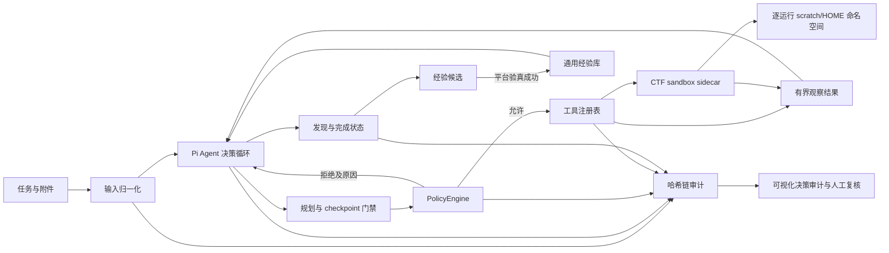

# 系统架构

## 设计目标

玄枢把模型视为“可替换的决策部件”，而不是安全边界。模型决定下一步做什么；运行时决定该动作是否在授权范围内、是否还有预算、结果如何持久化以及何时必须停止。

## 核心边界

| 模块 | 职责 | 不负责 |
| --- | --- | --- |
| `input.ts` | 解析任务、文件、目录与 ZIP，限制资源占用 | 不执行附件内容 |
| `runtime.ts` | 驱动 Pi、状态转换、预算、持久化、工具 cleanup | 不绕过策略执行工具 |
| `policy.ts` | 计划门禁、路径/主机/端口/程序范围、停滞与预算控制 | 不相信模型自报范围 |
| `tools.ts` | 只读输入、有限图片观察、scratch 写入、sandbox 命令、HTTP/TCP、发现与终止 | 不在 API/model 进程内执行 CTF 命令 |
| `sandbox.ts` | Unix socket sidecar 协议、结构化命令执行、输出和超时上限 | 不持有模型密钥或出网授权 |
| `audit.ts` | 顺序化写入和 SHA-256 前向哈希校验 | 不替代外部不可篡改存储 |
| `trace.ts` / `dashboard.ts` | 将审计记录投影为外显决策时间线，接受人工纠错 | 不展示或推断隐藏思维链 |
| `experience.ts` | 脱敏、平台验真后晋升、按类别检索和人工启停通用经验 | 不保存题号、flag、固定地址或未经验证的答案 |
| `skill-catalog.ts` | 将固定版本的开源 CTF skill 归一化为类别、技术族和 pivot 信号 | 不执行上游脚本、不继承外部工具权限、不把上游内容当证据 |
| `server.ts` | 健康检查、异步运行、鉴权、审计台与复核 API | 不允许远程扩大配置范围 |
| `manual-jobs.ts` | 有界批处理与同题多 agent 竞速；首个通过验证闸门的 run 胜出并取消同题其余 run | 不改变任务 scope，不让未经验证的 submission 结束竞速 |
| `shared-evidence.ts` | 提供同题 race 内有界、脱敏、带来源的事实/候选/dead-end 交换 | 不作为跨题知识库，不共享 scratch，不把其他 agent 的结论当作已验证事实 |

## 自主性机制

1. `submit_plan` 是所有调查动作的前置条件，计划包含假设、待验证假说、成功标准和候选工具。
2. 连续动作达到阈值后，策略层只允许 `checkpoint` 等元工具，迫使智能体总结证据和调整计划。
3. 相同工具与参数超过重复阈值会被拒绝，避免无进展循环。
4. `record_finding` 要求证据和置信度，`finish_task` 要求明确的完成或阻塞状态。
5. 轮次、工具、HTTP、TCP、时间、scratch 文件和输出量均有独立上限；任何一个上限都不能由模型提高。
6. 每个模型请求（包括并发运行的首轮请求）都经过进程共享的滚动 RPM/TPM 门控；请求按估算上下文和最大输出预算预约额度，等待与预约写入审计链，并接受 `AbortSignal` 终止。
7. CTF 任务先做通用 triage，再根据证据在 web、pwn、crypto、reverse、forensics、malware、OSINT、misc、AI/ML 之间 pivot。
8. Arena 完成前必须调用 `record_lesson` 记录通用经验候选；只有平台接受提交后才写入经验库，后续运行仍必须重新验证。
9. 任务类别命中时只加载一个经过审查且长度受限的 skill 索引。它与 playbook 一样只是决策提示，任何行动仍需经过工具注册表和 `PolicyEngine`。
10. `observe_image` 与其他调查动作一样经过 `PolicyEngine`，检查安全相对路径、单图字节上限和 run 级观察次数；其副作用仅为读取文件、返回模型上下文，并追加不含像素的 `image.observed` 审计事件。
11. Arena 完成要求候选答案出现在至少两条验证记录中，并同时绑定到 confirmed hypothesis、高置信度 finding 和空的 remainingRisks；`independentlyVerified` 不能单独充当证据。
12. Arena 可由 operator-owned `arena.allowedCategories` 限定题型；不在 allowlist 的题目不会启动模型、不会自动放弃，作业会停止并保留当前题供 operator 调整配置后重试，避免触发平台 early-abandon 冷却。
13. 持续作业会把错误提交或阻塞题归档到 `.xuan-shu/wrong-questions/`，保留题面、失败原因、运行统计和附件副本；记录不包含模型凭据、会话 Cookie、Authorization 或隐藏推理。
14. 同题竞速共享题目准备结果和进程内 `SharedEvidenceBoard`，不共享可变工作目录；每个 agent 使用独立 run/scratch。证据板最多 64 条、64 KiB，只保存脱敏后的 fact/candidate/dead-end，并记录来源 run。读写工具属于策略控制的调查动作，消耗工具与 checkpoint 预算并写入 `collaboration.evidence_*` 审计事件；共享内容必须独立复核。
15. winner 必须提供结构化 submission、`independentlyVerified=true` 和包含该 submission 的 verification 记录，随后统一停止并等待 loser 收尾，避免后台 run 或题目实例泄漏。

## 隔离与可观测性

- sidecar 为每个 run-id 建立独占的 `scratchRoot/runs/<run-id>`，命令的 cwd、`HOME`、`TMPDIR` 和路径校验都绑定到该目录；附件复制到本次运行的只读 `inputs/`。
- 手工上传接口只接受经过校验的叶子文件名，流式执行单文件、文件数和批次总量预算；上传暂存在 `scratchRoot/manual-uploads/`，提交后只供对应批次读取，并在批次结束时删除。服务令牌保护上传入口，响应不返回服务器文件路径。
- `workspaceMode=attachments-only` 时，文件工具的 workspace 根目录就是本次运行的只读 `inputs/`；共享 workspace 不会被列出，`run_command(cwd=workspace)` 被策略拒绝。图片在上下文之外只保留 MIME、大小和 SHA-256 等摘要。
- 该机制消除正常工具协议下的跨题 scratch 污染。Docker sidecar 仍是所有运行共享的 OS 容器；需要互不信任租户级的内核隔离时，应由部署层为每次运行调度独立容器或 microVM。
- `audit.jsonl` 是事实源，审计台只展示 `plan.submitted`、`policy.decision`、`tool.result`、`decision.checkpoint`、`finding.recorded`、`lesson.captured` 和运行结果。
- 人工复核写入独立 `reviews.jsonl`，不修改原始哈希链，因此原始行为与事后修正可以同时追溯。

## 威胁模型

- 提示注入：附件和网站内容均是不可信数据；系统约束与策略执行在模型之外。
- 范围扩张：单次请求只能缩小 operator-owned 配置，不能从 `observe` 提升到 `controlled`。
- 命令注入：`run_command` 通过 Unix socket 交给 `ctf-sandbox` 执行，使用 `spawn(program, args)` 且 `shell=false`，程序与路径在 policy 和 sidecar 两层检查。
- 进程隔离：API/model 进程不执行 CTF 命令；Docker 部署中 sidecar 不接收模型 key，challenge input 只读挂载，每次运行只使用自己的 scratch/HOME 命名空间。
- 出网隔离：Docker sidecar 使用 `network_mode: none`；远程 web/pwn 只能走经过 `PolicyEngine` 的 HTTP/TCP 工具。
- SSRF/重定向：HTTP 只允许配置主机并使用 `redirect=manual`。生产阶段还需增加 DNS 解析锁定和出口代理。
- 凭据泄露：审计与会话按敏感字段名脱敏，模型密钥只从环境变量读取。
- 资源耗尽：输入、ZIP、工具输出、请求体、scratch 文件、TCP 字节数、轮次与时间均设置上限。

## CTF sandbox profile

`tools/ctf/capabilities.json` 是能力 manifest。默认 core profile 覆盖：

- Web/API：HTTP 工具、curl/sqlmap/flask-unsign/requests/jq。
- Pwn：pwntools、ROPgadget、ropper、gdb、checksec、seccomp-tools、one_gadget、qemu-user、binutils。
- Crypto：pycryptodome、sympy、gmpy2、py_ecc、hashpumpy；`fpylll+cysignals` 提供可用的 LLL/BKZ 基础，Z3/OR-Tools 提供 SMT 与 CP-SAT，`ecm`、`gp`、`factor`、`bc` 提供有界的整数分解和数论 CLI。
- Reverse/Malware：file/strings/xxd/binutils、capstone、unicorn、lief、pefile、yara、oletools、apktool。
- Forensics/Misc/OSINT：binwalk、foremost、exiftool、tshark、sleuthkit、ffmpeg/ffprobe、ImageMagick、SoX、minimodem、multimon-ng、zbar/qrencode、Tesseract、pngcheck/gifsicle、steghide/outguess/stegsnow、Pickora、Pillow/numpy/matplotlib。

Heavy profile 通过 `INSTALL_HEAVY=true` 可选安装 angr、qiling、frida-tools、torch、transformers、SageMath、RsaCtfTool、CADO-NFS、flatter、radare2 和 stegseek。源码工具固定到 `capabilities.json` 中的 commit，并由 `verify-heavy-tools.sh` 做构建期 smoke test；Ghidra 和 GPU hashcat 调优仍作为人工确认的重型扩展。

这些能力是 sandbox programs，不是新的核心 AgentTool。它们只在无外网 sidecar 内通过 `run_command` 执行，并接受 `PolicyEngine` 的 operator-owned 程序白名单、总工具调用预算、重复动作与 checkpoint 门禁。读取型命令只观察输入；转换、OCR、隐写提取和 Pickora 可在本次运行的 scratch 命名空间内创建文件；分解、约束、OCR、音频和密码尝试可能消耗较多 CPU。所有命令受统一超时、AbortSignal 终止和 stdout/stderr 字节上限约束，每次调用都会写入 `policy.decision` 与 `tool.result` 审计事件。

镜像构建会运行 `tools/ctf/verify-core-tools.sh`：检查声明的 CLI、导入关键 Python 模块，并执行最小 LLL、CP-SAT 与 Z3 smoke test。heavy 构建额外验证固定源码工具、SageMath 和关键 Python 模块；它体积较大，且分解、符号执行和 ML 工作负载仍受同一命令超时与资源预算。远程交互依然只能使用作用域内的 HTTP/TCP AgentTool；题目依赖中的 netcat 不会因此进入 Arena/default 程序白名单，运行中也禁止临时调用包管理器扩展能力。

当前默认、Arena 和 Wanqing NSS 配置将 Arena 题型 allowlist 设置为 `crypto`、`misc`；核心循环仍不认识题目专属逻辑，其他部署可通过省略该 operator 配置恢复全题型模式。

开源 skill 来源、固定版本与内容筛选规则见 [`skills/README.md`](../skills/README.md)。外部 skill 的网络、shell 或安装权限不会进入运行时。

## 扩展协议

新增核心 AgentTool 需要同时提交：TypeBox 输入模式、工具实现、策略规则、审计事件、输出上限、AbortSignal 处理、单元测试和副作用说明。新增 sandbox program 需要更新锁定依赖、能力 manifest、operator allowlist、构建期 smoke check、策略/预算回归和副作用说明；它仍只能经 `run_command` 进入审计链。受控浏览器等主动网络工具必须保持逐运行隔离并经过 `PolicyEngine`；Burp、重型反编译器或取证工具应作为插件或 sandbox profile 加入，不应修改核心状态机。
