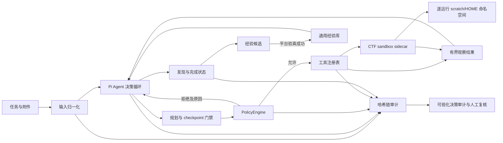

# 系统架构

## 设计目标

玄枢把模型视为“可替换的决策部件”，而不是安全边界。模型决定下一步做什么；运行时决定该动作是否在授权范围内、是否还有预算、结果如何持久化以及何时必须停止。

## 核心边界

| 模块 | 职责 | 不负责 |
| --- | --- | --- |
| `input.ts` | 解析任务、文件、目录与 ZIP，限制资源占用 | 不执行附件内容 |
| `runtime.ts` | 驱动 Pi、状态转换、预算、持久化、工具 cleanup | 不绕过策略执行工具 |
| `policy.ts` | 计划门禁、路径/主机/端口/程序范围、停滞与预算控制 | 不相信模型自报范围 |
| `tools.ts` | 只读输入、scratch 写入、sandbox 命令、HTTP/TCP、发现与终止 | 不在 API/model 进程内执行 CTF 命令 |
| `sandbox.ts` | Unix socket sidecar 协议、结构化命令执行、输出和超时上限 | 不持有模型密钥或出网授权 |
| `audit.ts` | 顺序化写入和 SHA-256 前向哈希校验 | 不替代外部不可篡改存储 |
| `trace.ts` / `dashboard.ts` | 将审计记录投影为外显决策时间线，接受人工纠错 | 不展示或推断隐藏思维链 |
| `experience.ts` | 脱敏、平台验真后晋升、按类别检索和人工启停通用经验 | 不保存题号、flag、固定地址或未经验证的答案 |
| `server.ts` | 健康检查、异步运行、鉴权、审计台与复核 API | 不允许远程扩大配置范围 |

## 自主性机制

1. `submit_plan` 是所有调查动作的前置条件，计划包含假设、待验证假说、成功标准和候选工具。
2. 连续动作达到阈值后，策略层只允许 `checkpoint` 等元工具，迫使智能体总结证据和调整计划。
3. 相同工具与参数超过重复阈值会被拒绝，避免无进展循环。
4. `record_finding` 要求证据和置信度，`finish_task` 要求明确的完成或阻塞状态。
5. 轮次、工具、HTTP、TCP、时间、scratch 文件和输出量均有独立上限；任何一个上限都不能由模型提高。
6. CTF 任务先做通用 triage，再根据证据在 web、pwn、crypto、reverse、forensics、malware、OSINT、misc、AI/ML 之间 pivot。
7. Arena 完成前必须调用 `record_lesson` 记录通用经验候选；只有平台接受提交后才写入经验库，后续运行仍必须重新验证。

## 隔离与可观测性

- sidecar 为每个 run-id 建立独占的 `scratchRoot/runs/<run-id>`，命令的 cwd、`HOME`、`TMPDIR` 和路径校验都绑定到该目录；附件复制到本次运行的只读 `inputs/`。
- 该机制消除正常工具协议下的跨题 scratch 污染。Docker sidecar 仍是所有运行共享的 OS 容器；需要互不信任租户级的内核隔离时，应由部署层为每次运行调度独立容器或 microVM。
- `audit.jsonl` 是事实源，审计台只展示 `plan.submitted`、`policy.decision`、`tool.result`、`decision.checkpoint`、`finding.recorded`、`lesson.captured` 和运行结果。
- 人工复核写入独立 `reviews.jsonl`，不修改原始哈希链，因此原始行为与事后修正可以同时追溯。

## 威胁模型

- 提示注入：附件和网站内容均是不可信数据；系统约束与策略执行在模型之外。
- 范围扩张：单次请求只能缩小 operator-owned 配置，不能从 `observe` 提升到 `controlled`。
- 命令注入：`run_command` 通过 Unix socket 交给 `ctf-sandbox` 执行，使用 `spawn(program, args)` 且 `shell=false`，程序与路径在 policy 和 sidecar 两层检查。
- 进程隔离：API/model 进程不执行 CTF 命令；Docker 部署中 sidecar 不接收模型 key，challenge input 只读挂载，每次运行只使用自己的 scratch/HOME 命名空间。
- 出网隔离：Docker sidecar 使用 `network_mode: none`；远程 web/pwn 只能走经过 `PolicyEngine` 的 HTTP/TCP 工具。
- SSRF/重定向：HTTP 只允许配置主机并使用 `redirect=manual`。生产阶段还需增加 DNS 解析锁定和出口代理。
- 凭据泄露：审计与会话按敏感字段名脱敏，模型密钥只从环境变量读取。
- 资源耗尽：输入、ZIP、工具输出、请求体、scratch 文件、TCP 字节数、轮次与时间均设置上限。

## CTF sandbox profile

`tools/ctf/capabilities.json` 是能力 manifest。默认 core profile 覆盖：

- Web/API：HTTP 工具、curl/sqlmap/flask-unsign/requests/jq。
- Pwn：pwntools、ROPgadget、ropper、gdb、checksec、seccomp-tools、one_gadget、qemu-user、binutils。
- Crypto：pycryptodome、z3、sympy、gmpy2、fpylll、py_ecc、hashpumpy。
- Reverse/Malware：file/strings/xxd/binutils、capstone、unicorn、lief、pefile、yara、oletools、apktool。
- Forensics/Misc/OSINT：binwalk、foremost、exiftool、tshark、sleuthkit、ffmpeg、zbar/qrencode、hashcat/john、dnsutils、whois、nmap、Pillow/numpy/matplotlib。

Heavy profile 可选安装 angr、qiling、frida-tools、torch、transformers。SageMath、Ghidra、RsaCtfTool 和 GPU hashcat 调优仍作为人工确认的重型扩展。

## 扩展协议

新增工具需要同时提交：TypeBox 输入模式、工具实现、策略规则、审计事件、输出上限、AbortSignal 处理、单元测试和副作用说明。浏览器、Burp、重型反编译器或取证工具应作为插件或 sandbox profile 加入，不应修改核心状态机。
