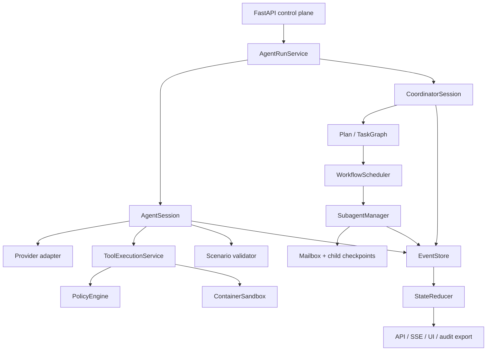
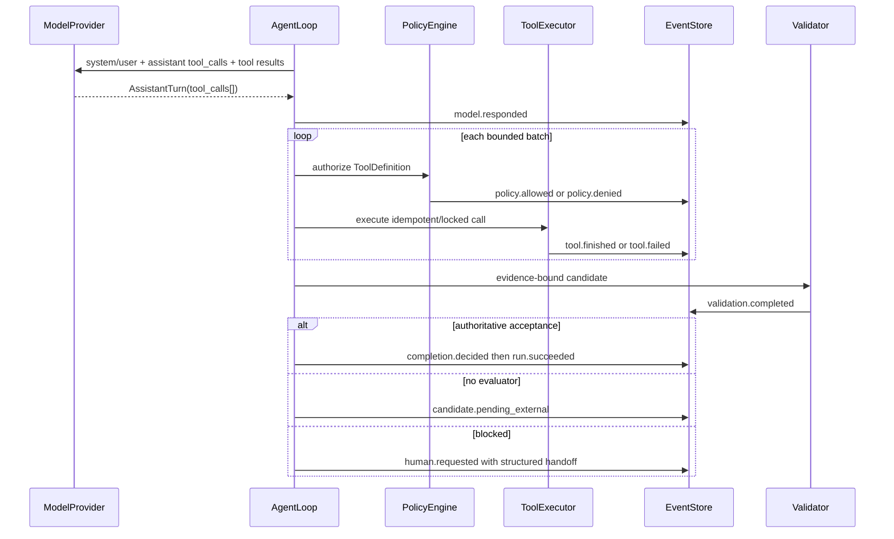

# Agent Engine v3 Architecture

## Authority

- `AgentSession` owns single-Agent lifecycle and terminal state.
- `CoordinatorSession` owns declarative multi-Agent workflow lifecycle.
- `AppendOnlyEventStore` is the audit and recovery source.
- `StateReducer` is the canonical projection function.
- `AgentRunService` is the only formal session construction path.
- scenario plugins own manifest, Plan, WorkflowSpec, completion schema, and validator.

## Native Tool Sequence

## Recovery

Events use contiguous per-run sequence numbers and schema version 1. Checkpoints store the reducer state,
budget usage, and event offset atomically. Provider tool-call IDs are replay keys; completed calls return their
stored result and non-idempotent tools are not repeated. Subagents persist independent summaries/transcripts
under `.agent_subagents/<agent_id>/.agent_state/`.

## Runtime Boundary

Formal API modules import `agent_engine` and `scenarios` only. The old orchestrator, old runtime, and bridge
remain compatibility/research code and have no default selection or fallback role.
