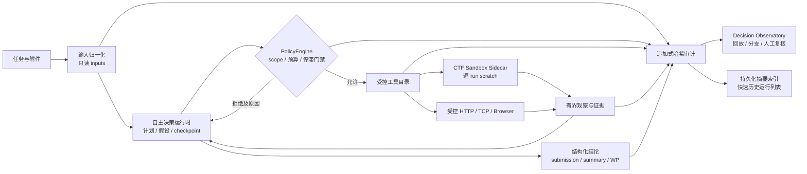
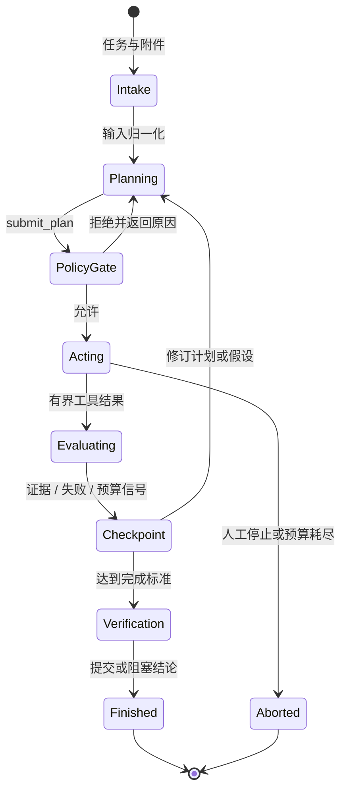

# XH-202609 方案设计文档

| 项目 | 内容 |
| --- | --- |
| 作品名称 | 烛龙·玄枢（ZhuLong XuanShu）——具备自主决策能力的通用网络安全智能体 |
| 文档编号 | XH-202609-01 |
| 版本 | 1.0 |
| 对应代码基线 | `723f047`（`main`） |
| 适用范围 | 明确授权的竞赛、教学靶场、实验室与安全研究任务 |
| 编制日期 | 2026-08-31 |

## 1. 项目概述

烛龙·玄枢是一个面向授权网络安全任务的自主决策运行时。它接收自然语言任务及文本、结构化数据、目录、压缩包、图像和二进制附件，将任务处理为“计划、假设、受控行动、证据、复核、结论”的闭环。系统的设计重点不是扩大模型执行权限，而是让模型在明确的授权、预算、隔离和审计约束中完成可解释的自主调整。

本方案不服务于未授权扫描、攻击或生产环境无人值守处置。模型不能直接取得网络、Shell 或配置扩权能力；所有主动网络行为均须通过 `PolicyEngine` 及运营方持有的 scope 配置，单次运行的 override 只能进一步收窄权限。

## 2. 需求定义与设计目标

### 2.1 问题定义

开放式安全任务的输入差异大，可能包含接口资料、日志、源码、二进制、压缩包和交互目标。固定脚本难以在证据不足、工具失败或假设被否定时调整路径；纯模型对话又不能作为权限边界，且其结论不一定可复核。系统因此需要同时解决以下问题：

1. 将复杂任务拆解为可验证的计划与假设，而不是生成不可追溯的长篇思考过程。
2. 将模型提出的每次行动限制在 operator-owned 的作用域、工具白名单和资源预算内。
3. 对工具结果、策略判定、失败分类和人工修正建立可回放的事实链。
4. 让终态结论、Flag 和 WP 均有结构化运行证据，避免由日志文字推断答案。
5. 在运行数量增多时保持控制台可用，并保留完整历史详情。

### 2.2 设计目标

| 目标 | 设计响应 | 可复核依据 |
| --- | --- | --- |
| 受约束自主性 | 计划、checkpoint、重复动作门禁和策略逐次判定 | `runtime.ts`、`policy.ts`、审计链 |
| 最小权限执行 | scope、程序 allowlist、逐 run scratch、无网络 sidecar | `policy.ts`、`sandbox.ts`、`docker-compose.yml` |
| 证据可追溯 | 追加式 SHA-256 前向哈希审计；请求、判定、结果按调用 ID 关联 | `audit.ts`、`trace.ts` |
| 面向比赛的可解释性 | Decision Observatory 展示事实投影、策略、证据、回放、分支和人工复核 | `frontend/src/pages/RunDetailPage.tsx` |
| 结论可交付 | 结构化 submission、严格验证闸门、终态 WP 生成与下载 | `submission-policy.ts`、`writeup-generator.ts` |
| 工程可维护性 | 模块化边界、确定性 faux-model 测试、`npm run check` 合并门禁 | `src/`、`test/`、`package.json` |

## 3. 总体架构

系统采用“模型负责判断，策略负责约束，工具负责执行，证据负责验证，审计负责追溯”的职责分离。模型只可调用公开、结构化、有界的工具；策略层与执行层不相信模型自报的权限或结果。

### 3.1 分层职责

| 层次 | 组件 | 主要职责 | 边界 |
| --- | --- | --- | --- |
| 输入层 | `input.ts`、附件工作区 | 归一化任务和附件；限制体积；建立只读 `inputs/` | 不执行附件内容 |
| 决策层 | `runtime.ts`、计划/假设/checkpoint | 驱动状态机，依据公开证据选择下一步 | 不直接绕过策略调用资源 |
| 策略层 | `PolicyEngine`、预算、Permission Gate | 校验主机、端口、路径、程序、模式、重复动作与停止条件 | 不信任模型提供的范围 |
| 执行层 | `tools.ts`、`sandbox.ts`、HTTP/TCP/Browser | 运行有界、可取消的观察或动作 | 不自行扩大网络或程序能力 |
| 事实层 | `audit.ts`、findings、handoff | 记录可关联、脱敏、可验证的事实 | 不保存密钥、Cookie、授权头或隐藏推理 |
| 展示层 | React Decision Observatory | 将同一事实源投影为任务、决策、证据、策略和结论 | 不猜测未记录的模型思维 |

## 4. 核心运行闭环

1. **计划先行。** 调查动作前必须提交计划，包含目标、成功标准、待验证假设和候选工具。
2. **逐次门禁。** 每个工具调用都经过 `PolicyEngine`。它核验 scope、路径、程序、网络端点、次数、字节、时间和重复动作，返回允许或拒绝原因。
3. **有界执行。** 工具采用结构化输入和限长输出；可能阻塞的操作接受 `AbortSignal`，可由超时、预算耗尽或人工停止取消。
4. **证据驱动修订。** 当出现空结果、工具故障、策略拒绝、矛盾证据或连续无进展时，运行进入 checkpoint。后续调查动作必须先说明失败分类、计划变化、下一步和依据。
5. **验证后收敛。** `record_finding` 记录证据与置信度；`finish_task` 写入完成或阻塞状态。严格提交任务的候选值须在成功工具输出中出现，并由独立验证文本逐字支持。

## 5. 安全控制与数据保护

| 风险 | 控制机制 | 可审计信号 |
| --- | --- | --- |
| 作用域扩张 | scope 由 operator 配置；per-run override 仅能收窄 | `policy.decision` |
| 未授权网络 | HTTP、TCP、Browser 均逐次通过 `PolicyEngine`；sidecar 无网络 | permission / policy 事件 |
| 命令注入 | sidecar 使用 `spawn(program, args)`，不经 Shell；程序须在 allowlist | `tool.requested`、`tool.result` |
| 附件攻击与资源耗尽 | 输入、ZIP、扫描前缀、输出、轮次、文件和运行时间均受上限 | 策略拒绝、截断与错误分类 |
| 无效循环 | 相同调用阈值、连续动作阈值、checkpoint 和策略修订门禁 | checkpoint / revision 事件 |
| 跨题污染 | 每个 run 独立 scratch/HOME/TMPDIR；附件只读 | run 级目录和工具结果 |
| 敏感信息泄露 | 统一脱敏；不写入 Key、Authorization、Cookie、图片像素或隐藏推理 | 运行产物检查、审计内容 |
| 恢复重放副作用 | 启动恢复只结算遗留状态，不自动重放未知副作用调用 | `run.recovered_after_restart` |

`audit.jsonl` 是运行事实源，采用顺序事件与 SHA-256 前向哈希。`tool.requested`、`policy.decision` 与 `tool.result` 使用同一工具调用 ID 关联；人工复核单独写入 `reviews.jsonl`，不修改原始事实链。恢复、回放和分支仅继承公开且已脱敏的轨迹投影。

## 6. 关键功能设计

### 6.1 决策观测台

运行详情页不是聊天窗口，而是基于真实状态和审计事件的 Decision Observatory。它展示任务状态、阶段、当前行动、计划与假设、策略判定、工具观察、证据图、策略修订、回放、分支、续接和人工复核。界面只解释“做什么、为什么、影响、结果、下一步”等可复核事实，不展示、持久化或推断隐藏 Chain of Thought。

前端从同一事件流构造决策时间线：技术事件保留可审计性，面向操作者的投影提供可读标签。事件按稳定序号回放，SSE 支持断线补收；重连后的 reducer 去重，避免将重复事件误显示为新的行动。

### 6.2 结论、Flag 与 WP

运行结束后，页面在“运行总结结论”区域展示 `finish_task` 产生的结构化 summary 和 submission。识别为 CTF 结果时，Flag 独立且醒目展示。该结论来自运行状态及验证记录，不从自由文本或日志猜测。

终态运行可以下载已有 WP；没有存储 WP 时，操作者可请求独立的生成步骤。生成器仅接收规范化任务、结构化状态、公开 transcript、受限工具结果、findings 和 verification，不接收隐藏推理或敏感凭据。文档会校验 YAML 元数据、`Summary`、`Solution`、完整可运行脚本、精确 Flag 和长度；最多两次尝试，失败时保留脱敏的结构化兼容报告而不伪造解题过程。

### 6.3 运行历史可用性

每个持久运行同时保存完整 `state.json` 与轻量 `summary.json`。运行列表优先读取摘要，旧运行缺失摘要时以“正在索引”状态返回并在后台补齐；打开详情仍读取完整状态和审计轨迹。这一设计将列表扫描与详情载入分离，避免大量历史产物阻塞控制台，同时保持历史事实不被列表索引改写。

### 6.4 附件与本地分析

控制台支持点击选择和拖拽附件。附件被复制到本次运行的只读输入边界。`extract_archive` 只将 ZIP 解压到当前 scratch，限制 500 个条目和 32 MiB，拒绝路径穿越与符号链接；`search_artifact` 在最多 16 MiB 前缀中进行 UTF-8 或十六进制搜索，限制模式、命中数与上下文。二进制、逆向、密码与取证工具通过受控的 `run_command` 使用，仍受程序 allowlist、输出、超时和 checkpoint 约束。

## 7. 可扩展性设计

新增模型可调用工具必须满足以下交付契约：

1. TypeBox 输入模式、明确的输出上限和错误语义；
2. 对阻塞工作完整传播 `AbortSignal`；
3. 经 `PolicyEngine` 与 operator-owned scope 授权，且明确预算消耗；
4. 可关联的策略和工具审计事件；
5. 策略、预算、取消行为的确定性测试；
6. 在 `docs/tool-side-effects.md` 记录副作用、数据边界和人工操作要求。

Sandbox program 不是绕过策略的新工具。它必须同时存在于镜像能力清单、operator allowlist 与 sandbox health 结果中，才可由 `run_command` 调用。真实模型评测不进入默认回归路径，应以 opt-in evaluation suite 固定数据、模型、预算、环境和轨迹引用。

## 8. 创新点与可追溯关系

| 创新点 | 工程实现 | 对应价值 |
| --- | --- | --- |
| 约束优先的自主性 | 模型请求与策略执行分离；计划、checkpoint 和停滞门禁 | 自主调整不等于无边界执行 |
| 轨迹即事实源 | 单一追加式审计链支撑审计、解释、回放、恢复与分支 | 降低多套日志不一致风险 |
| 可治理的工具扩展 | 新工具的策略、预算、审计、取消和文档门槛 | 让能力扩展保持可控、可测 |
| 提交与 WP 证据闭环 | 严格 submission 闸门、最终结论、Flag 显示、结构化 WP | 面向竞赛交付的可复核结果表达 |
| 兼顾规模的历史审计 | 完整状态与轻量摘要双层持久化 | 历史运行增多仍可快速检索 |

## 9. 需求追溯矩阵

| 需求 | 实现模块 | 验证入口 | 交付材料 |
| --- | --- | --- | --- |
| 自主规划、执行、验证和纠错 | `runtime.ts`、计划/假设/checkpoint | `npm run check` 的运行时测试 | 本文、开发文档、技术报告 |
| 网络与命令安全边界 | `policy.ts`、`tools.ts`、`sandbox.ts` | 策略/预算/sidecar 测试 | 架构文档、测试报告 |
| 决策可解释与可回放 | `audit.ts`、`trace.ts`、前端投影 | 轨迹投影测试与前端构建 | 用户部署手册 |
| Flag、结论与 WP | `submission-policy.ts`、`writeup-generator.ts`、Run Detail | 严格提交和写作生成测试 | 用户部署手册 |
| 运行历史性能 | `run-summary.ts`、`trace.ts`、Runs 页面 | 运行摘要和恢复测试 | 开发文档、测试报告 |
| 一键部署 | Dockerfile、Compose、`start.command`、`start.bat` | Compose 配置解析 | 用户部署手册 |

## 10. 设计结论

烛龙·玄枢的核心不是让模型“多做动作”，而是将可调整的模型决策放在不可绕过的运行时约束中。由此形成的计划、策略、工具、证据、结论和审计闭环，使系统能够在授权场景下展示自主决策能力，同时保留安全边界、可解释性和比赛交付所需的复核条件。

详细模块职责、威胁模型和副作用矩阵分别见 [系统架构](../architecture.md)、[工具副作用与审计契约](../tool-side-effects.md) 和 [评测协议](../evaluation.md)。
