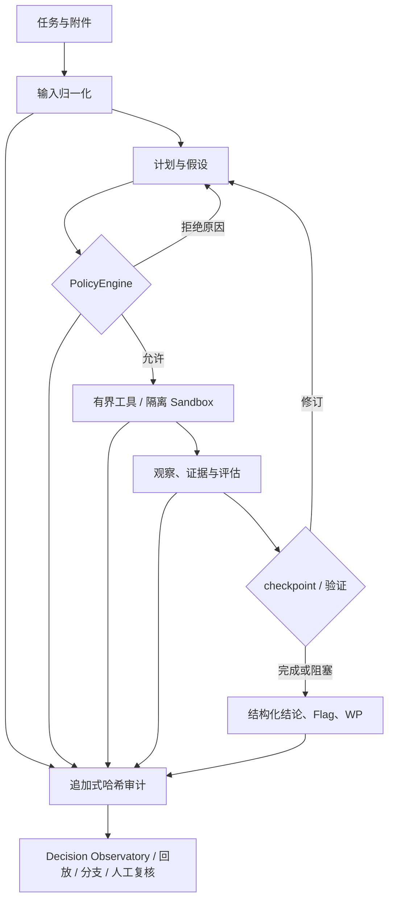

# XH-202609 技术报告

| 项目 | 内容 |
| --- | --- |
| 文档编号 | XH-202609-05 |
| 版本 | 1.0 |
| 对应代码基线 | `723f047`（`main`） |
| 作品名称 | 烛龙·玄枢——具备自主决策能力的通用网络安全智能体 |
| 编制日期 | 2026-08-31 |

## 摘要

烛龙·玄枢是面向明确授权网络安全任务的自主决策智能体运行时。系统将大模型限定为任务理解、计划、假设生成和下一步行动选择组件，以 `PolicyEngine`、operator-owned scope、资源预算、结构化工具协议、逐运行隔离和追加式审计链定义不可由模型绕过的工程边界。针对安全任务中输入异构、失败恢复困难、结论难以复核和执行风险高的问题，项目构建了计划先行、策略逐次判定、证据驱动修订、严格提交验证和可回放观测的统一闭环。

当前版本实现了前端 Decision Observatory、结构化最终结论与 Flag 展示、终态运行的可下载 WP、拖拽附件、进程内临时模型配置、持久化运行摘要索引、Docker Compose 及一键启动脚本。确定性回归、前后端构建和 Compose 配置解析均已通过；该结论仅说明工程基线满足交付门禁，不把一次运行或本地演示误表述为真实比赛成功率。

**关键词：** 安全智能体；自主决策；策略引擎；最小权限；可解释审计；CTF Write-up；运行时治理

## 1. 研究背景与问题

网络安全任务常混合自然语言目标、日志、接口资料、源码、二进制、压缩包和受控网络交互。传统自动化通常依赖固定流程，面对材料变化、工具失败和证据冲突时缺少自适应能力；大模型虽然能够提出策略，却会带来权限扩张、重复尝试、不可验证结论和敏感信息泄露风险。

本项目的核心判断是：安全智能体的价值不在于让模型直接获得更多工具，而在于让模型在严格可执行的边界内完成有证据的策略调整。因此需要回答四个工程问题：

1. 如何把模型的自然语言判断转换成可校验的行动请求？
2. 如何保证网络、命令、文件和资源约束不依赖模型自觉遵守？
3. 如何在失败后强制产生可解释的策略修订，而不是盲目重试？
4. 如何将最终结论、Flag、WP 和人工复核建立在同一事实源上？

## 2. 技术路线

项目采用五层协同：输入层负责资源受限的材料归一化；决策层维护计划、假设和 checkpoint；策略层核验授权和预算；执行层运行有界工具；事实层以审计链记录可复核事件，并投影给前端。模型可以提出下一步，但不能自行改变 scope、程序白名单、网络权限、输出上限或停止条件。

## 3. 系统实现

### 3.1 受约束自主决策

运行必须先提交包含目标、成功标准、假设和候选工具的计划。每次工具调用先经过 `PolicyEngine`，检查 scope 模式、精确主机/端口、路径、程序、预算、重复调用和连续动作阈值。达到停滞、失败或节奏阈值后，运行只允许 checkpoint 类动作：Agent 必须记录失败分类、证据、计划变化、下一步及其依据，才可继续调查。

该机制将“自主”落实为可观察的计划、行动和修订，而非展示或存储隐藏思维过程。结论通过结构化 `finding`、`verification`、`submission` 与 `finish_task` 记录；严格任务要求候选值同时出现在成功工具结果和独立验证文本中。

### 3.2 策略、安全与隔离

所有主动网络能力必须通过 `PolicyEngine` 和 operator-owned scope。单次运行 override 只能收窄既有范围。`run_command` 经 Unix socket 发往 sandbox sidecar，以程序与参数的结构化形式启动，不经过 Shell；每个 run 拥有独立 scratch、`HOME` 和 `TMPDIR`，附件为只读输入。Compose 中 sandbox 使用 `network_mode: none`，主动网络仅可通过受 scope 控制的 HTTP/TCP/Browser 工具完成。

工具协议要求 TypeBox 输入模式、有界输出、`AbortSignal`、预算、审计与确定性测试。二进制方向提供受限 ZIP 解压和字节搜索，分别限制解压条目/总量及扫描前缀/模式/命中/上下文；Radare2、JADX、Pwntools、`gdb-multiarch`、`ltrace` 等只可在固定能力清单、镜像、健康检查和 operator allowlist 同时满足时使用。

### 3.3 追加式事实链与决策可解释性

`audit.jsonl` 为运行事实源。事件使用顺序号和 SHA-256 前向哈希；工具请求、策略决策和工具结果以同一调用 ID 对应，并标记来源、执行者、关联 ID 和父序号。公开模型上下文、知识注入、工具摘要和状态变化能够回放，但模型 Key、Authorization、Cookie、图片像素和隐藏推理不会写入产物。

React 控制台从同一事实源派生 Decision Observatory：任务 HUD、决策时间线、当前行动、假设、证据关系、策略详情、原始事件、审计完整性、回放、分支、续接和人工复核。UI 不按时间猜测因果关系，也不把聊天文本包装为模型思考。人工复核写入独立文件，因此可校正解释而不篡改原审计事实。

### 3.4 终态结论与竞赛 WP

Run Detail 将终态的 summary 和结构化 submission 作为“运行总结结论”展示；当结果是 CTF Flag 时，使用明确的 Flag 字段突出显示。WP 不由主 Agent 的自由文本直接充当：终态运行可触发独立生成器，生成器只读取任务、结构化状态、公开 transcript、受限工具结果、findings 和验证记录，并要求 YAML 元数据、简明解题过程、完整可运行脚本和精确 submission。生成次数、长度和超时均有限制；格式或事实不足时不制造内容，回退为脱敏兼容报告。

### 3.5 持久化、恢复与可用性

每个运行保存完整 `state.json`、审计、findings、transcript、review 和 handoff。为了避免历史运行较多时列表逐一载入完整状态，`723f047` 增加 `summary.json`：列表优先读摘要，缺少摘要的旧运行以 `indexing` 状态异步回填；详情仍读完整状态。服务重启采用 no-replay，只结算遗留的非终态运行，避免自动重新执行副作用未知的工具调用。

## 4. 工程质量与验证

本报告对应代码基线 `723f0475fbbde81af8ab8056668f17df4da7ff2e`。在 Node.js `v26.3.0` 环境中，`npm run check` 通过，包含 typecheck、ESLint、后端构建及确定性测试：61 个测试文件通过、1 个跳过，387 个用例通过、1 个跳过。`npm --prefix frontend run build` 通过；`XUANSHU_SERVER_TOKEN=validation-only docker-compose config` 通过。对 320 条有效历史运行的列表读取冒烟结果为 `pending=0`，`/v1/runs` 约 79 ms。

验证范围覆盖 scope、预算、审计关联、恢复 no-replay、提交/WP、附件分析、工具能力清单、前端事实投影和摘要索引。此处没有声称已在本机完成 Docker 镜像构建、容器启动或真实模型/比赛平台评测；这些项目必须由现场授权环境依据 [测试报告](03-test-report.md) 的复测清单完成。

## 5. 创新性与应用价值

| 维度 | 技术贡献 | 应用价值 |
| --- | --- | --- |
| 自主性治理 | 计划先行、逐次策略门禁、停滞检测、checkpoint 和失败修订 | 避免将“会调用工具”误当作可靠自主性 |
| 事实统一 | 一条追加审计链支撑技术审计、可读轨迹、回放、恢复和分支 | 减少日志、UI 和恢复状态彼此矛盾 |
| 工具可治理 | 新工具的输入、预算、取消、审计、测试与副作用文档门槛 | 能力扩展不牺牲可控性 |
| 竞赛结果表达 | 严格 submission、明确 Flag、终态 WP 与下载 | 将解题结论与公开证据、完整脚本关联 |
| 工程可用性 | Docker Compose、一键脚本、内存模型设置、拖拽附件、摘要索引 | 降低现场部署与长历史运行的操作成本 |

## 6. 局限与边界

1. 项目不应被用作无人值守生产扫描器，也不替代人工对授权范围、风险和最终提交的判断。
2. Docker sidecar 可隔离单次运行的文件空间与网络，但若面向互不信任的多租户，需要部署层提供每运行独立容器或 microVM。
3. 公开工程门禁不能替代真实模型评估；模型、数据集、环境、预算与多次实验必须由评测账本固定后再报告指标。
4. 生产级 SSRF 防护仍需要部署侧 DNS 解析锁定和出口代理等进一步措施。
5. WP 生成仅在公开证据足以支撑时提供完整脚本，证据不足时应明确复现缺口，不能为形式完整而编造攻击链或答案。

## 7. 结论

烛龙·玄枢将安全智能体中“模型能否自主调整”与“系统能否安全、可审计地执行”统一到一套运行时协议中：模型负责理解、计划和选择，策略负责权限和预算，工具负责有界执行，证据负责验证，审计负责追溯。该方案保持核心循环领域中立，并通过结构化结论、Flag/WP 交付、前端决策观测和容器化启动，为授权安全竞赛和研究场景提供可复核的工程底座。

相关材料包括 [方案设计文档](01-solution-design.md)、[开发文档](02-development-guide.md)、[测试报告](03-test-report.md)、[用户与部署手册](04-user-and-deployment-guide.md)、[系统架构](../architecture.md) 和 [评测协议](../evaluation.md)。
