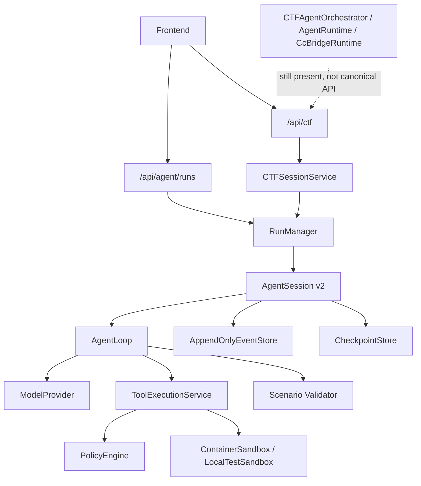

# Agent Engine v3 Baseline Audit

Date: 2026-07-14
Branch: `codex/refactor-agent-engine-v3`
Protected snapshot: `7f0637c` (`chore: snapshot agent engine v2 worktree`)
Starting HEAD: `1abea88`

## Scope and method

The audit inspected the current Git worktree, the v2 engine, scenario services, API routes,
legacy runtime imports, focused tests, benchmark metadata, and release checks. Secret values
were not read or copied. The original 226-file teammate worktree was committed before v3
changes so every later phase can be reverted independently.

## Runtime call graph



## Preserved capabilities

- `AgentSession` is the v2 lifecycle owner and writes idempotent terminal events.
- Append-only events, atomic checkpoints, abort propagation, process-group cleanup, and
  checkpoint resume already have focused tests.
- Tool schema, policy, executor, sandbox, skill index/loader, CTF adapter, event projection,
  and release exclusions are useful foundations and will be evolved in place.
- The CTF API currently uses `CTFSessionService`, so it no longer starts the old orchestrator
  in its normal route path. Legacy modules remain imported by legacy tests and code.
- Release inspection excludes local databases, runtime workspaces, dependency trees, and
  recovered vendor sources.

## Confirmed gaps

1. `SessionState.current_plan`, facts, and hypotheses are mutable fields without canonical
   events or replay reducer behavior.
2. `ContextBuilder` emits tool outcomes as JSON user messages. It does not reconstruct the
   assistant `tool_calls` message followed by `role=tool` messages paired by call ID.
3. Provider construction uses process-global settings; `RunRequest.model_config` does not
   control base URL profile, timeout, routing roles, or parallel-tool behavior.
4. Multiple model tool calls are executed serially and tool definitions do not declare
   idempotency, side effects, locks, parallel safety, approvals, or evidence type.
5. Three no-tool turns transition directly to `human_required`; there is no stuck diagnosis,
   reviewer/refuter path, local replanning, or structured handoff record.
6. There is no persisted Plan DAG, Task, Fact, Hypothesis, Evidence, Contradiction, Decision,
   or Artifact contract.
7. There is no Coordinator, SubagentManager, mailbox, bounded fan-out/fan-in scheduler, or
   declarative workflow primitive implementation.
8. Pentest, vulnerability analysis, incident response, and reverse/forensics expose completion
   schemas but no executable role topology or workflow.
9. API-created CTF candidates without an evaluator are rejected instead of remaining in an
   explicit pending-external-validation state.
10. The UI projection is CTF/legacy shaped and does not expose plan revisions, agent lanes,
    hypothesis state, human answers, or resume actions.
11. Legacy runtime modules and bridge configuration remain in the tree. They need explicit
    experimental isolation after canonical API compatibility is proven.
12. Benchmark fixtures expanded from 10 to 25 cases without updating two assertions. The
    checked-in result correctly labels itself as deterministic mock data and reports poor
    validation; it is not a live solve-rate claim.

## Baseline evidence

Commands use `/Users/j1k3r/miniforge3/bin/python3` (Python 3.13.13).

```text
python -m pytest -q backend/tests/test_agent_engine_*.py
44 passed, 2 failed, 5 skipped

failures:
- test_benchmark_expected_metadata_is_not_in_public_challenge_descriptions
- test_benchmark_report_is_honestly_labeled

python scripts/check_release.py
passed; local runtime/private files were reported as excluded

python -m pytest -q
400 passed, 2 failed, 5 skipped, 463 warnings in 125.09s
```

The focused failures are stale test expectations (`10` cases and `agent_session_mock`) against
the checked-in 25-case manifest and explicitly labeled `agent_session_mock_hidden_25` report.
They are recorded rather than hidden or skipped.

## Risk and rollback

- Every phase is committed separately after its focused test gate.
- Event schemas are additive and versioned; old v2 JSONL remains readable by the reducer.
- API response compatibility is maintained through projections while canonical v3 fields are
  added.
- Uploaded inputs stay read-only; derived artifacts use the run workspace.
- Provider secrets remain process-only and are removed before event/checkpoint serialization.
- `7f0637c` is the exact rollback point for all pre-v3 teammate work.
