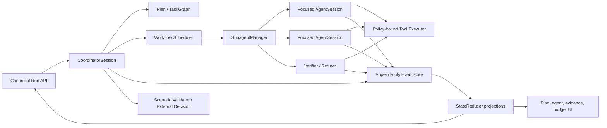

# ADR: Agent Engine v3 Native Orchestration

Status: accepted
Date: 2026-07-14

## Decision

Evolve the existing Python Agent Engine in place into v3. The canonical runtime remains an
`AgentSession` backed by an append-only `EventStore`; a `CoordinatorSession` composes the same
session primitives for plan-driven multi-agent work. A `StateReducer` becomes the only way to
derive current state from canonical events.

Claude/Codex-style orchestration semantics are implemented as typed Python contracts and
declarative workflows. An external coding-agent CLI is not the production execution engine.
The existing bridge is retained only under an explicit experimental module/configuration and
never participates in fallback selection.

## Alternatives considered

### Wrap a CLI subprocess

Rejected for the production path because tool calls, policy decisions, evidence binding,
budgets, and validation would be hidden behind a text transcript and could not be replayed
reliably.

### Replace the v2 package wholesale

Rejected because its event store, lifecycle ownership, policy, sandbox, skill loading,
checkpointing, adapters, and tests already enforce valuable invariants.

### Keep a single linear loop and add prompts

Rejected because planning, hypothesis state, bounded concurrency, independent verification,
and recovery are executable state-machine concerns rather than prompt wording concerns.

## Architecture

## Canonical contracts

- `Plan` is versioned and contains a validated task DAG, alternatives, risks, unknowns,
  critical path, rationale, and revision reason.
- `Fact`, `Hypothesis`, `Evidence`, `Contradiction`, and `DecisionRecord` are immutable event
  payloads with stable IDs and provenance.
- `Artifact` owns immutable input metadata, hashes, derived relationships, extraction records,
  risk labels, visibility, and evidence references.
- `WorkflowSpec` contains serializable primitive nodes. Validation rejects cycles, invalid
  roles/tools, impossible budgets, and unbounded termination.
- `SubagentManager` enforces global/role concurrency, budget, context, tool, scope, artifact,
  and workspace policies. Every child has a transcript and structured handoff.
- Native transcript messages preserve assistant tool calls and paired tool results.

## Lifecycle and completion

`AgentSession` remains the only owner of run status. Candidate state is separate from run
terminal state: detected, locally validated, pending external, externally accepted, externally
rejected, or human required. Only a completion policy can produce a terminal run event.

No evaluator means pending external validation with preserved evidence, not success and not a
false rejection. A human answer appends a canonical event, restores the checkpoint, and resumes
the same session.

## Concurrency

Only calls marked idempotent, parallel-safe, and free of conflicting resource locks are eligible
for bounded parallel execution. Mutating or high-risk calls remain serialized and still emit a
policy decision. Model retries never repeat a completed non-idempotent tool call.

## Consequences

- Additional contracts and events increase code volume, but replace implicit dictionary state
  with replayable behavior.
- Event migration must remain backward compatible with the v2 schema.
- Multi-agent execution can be deterministic in tests by using scripted providers and local
  fixture sandboxes; live-model claims remain a separate opt-in benchmark tier.

