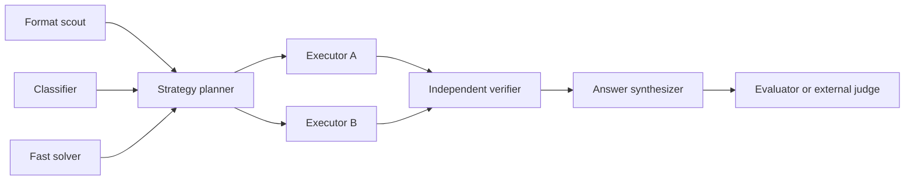

# Five Scenario Workflows

Every scenario exposes a `ScenarioManifest`, versioned `Plan`, validated `TaskGraph`, serializable `WorkflowSpec`,
completion schema, and validator. Workflow validation checks task IDs, cycles, roles, tools, budgets, concurrency,
quorum, retry/loop bounds, and termination.

## CTF

Candidate states are found, locally validated, pending external, externally accepted/rejected, and human required.
No evaluator produces `pending_external`, preserving evidence without claiming success.

## Scoped penetration test

Scope scout precedes planning. Enumeration and evidence collection fan out only from the request allowlist. A
verifier checks reproduction and a synthesizer emits finding, scope, evidence, and remediation. Network requests
remain policy-bound and can require explicit tool approval.

## Vulnerability analysis

Structure scan, data-flow analysis, and dependency/configuration checks run in parallel. A bounded test constructor
and reachability executor feed an impact verifier. Pattern matches alone do not satisfy completion.

## Incident response

Log normalization, IOC extraction, and timeline construction run in parallel, followed by correlation, root-cause
analysis, chain-of-custody verification, and a response summary. Suggested containment actions carry impact and
rollback context; the workflow does not silently execute them.

## Reverse engineering and forensics

File identification, strings/imports, and segment analysis fan out before behavior planning. Sample execution uses
the sandbox policy. Verification cites artifact hash, function/offset/locator, logs, or a reproducible experiment.

The offline scenario test executes all five WorkflowSpecs through the same scheduler. The Coordinator fixture runs
the CTF DAG through real bounded SubagentManager workers, mailboxes, child workspaces, events, and checkpoints.
